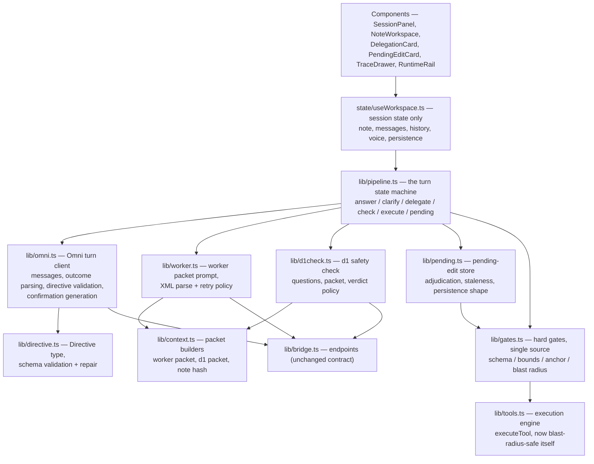

# Architecture Refactor Plan — Supervisor-First → Omni-First

- **Status:** Implementation plan, 2026-11-09. Companion to
  [`design.md`](./design.md), which is the authoritative spec; this document is
  *how* the code gets there. Where the two disagree, design.md wins and this
  plan gets fixed.
- **Scope:** `src/state/useWorkspace.ts` (2,037 lines — the monolith that owns
  every pipeline stage today), `src/lib/supervisor.ts` (1,915 lines),
  `src/lib/worker.ts`, `src/lib/bridge.ts`, `src/lib/tools.ts`,
  `src/lib/storage.ts`, `src/types.ts`, the session/note/rail components,
  `scripts/qa-suite.mjs`, and `scripts/start-models.sh`. The execution engine's
  splice mechanics, the snapshot stack, the XML contract, the bridge endpoints,
  VAD/ASR capture, and the UI shell are **retained** (design.md §12).
- **Strategy in one line:** strangler, not big-bang — extract the pipeline out
  of the hook with behaviour preserved, prove the three model behaviours the
  design bets on with spikes, then swap one stage at a time behind a flag,
  deleting each piece of the supervisor only when its replacement has passed
  its gate.

---

## 1. Ground rules (apply to every phase)

1. **Runnable at every phase boundary.** Each phase lands as its own PR, passes
   `npm run typecheck` + `npm run build`, and leaves the app fully usable with
   the flag in either position (until the flag is removed in P6).
2. **One flag.** `OMNI_FIRST` in a new `src/lib/flags.ts`, defaulting to the
   *old* pipeline until P2, flipped per-phase as gates pass, removed in P6.
   No per-stage flags — partial configurations are how the shipped build got
   four inconsistent d1 thresholds.
3. **No fake stages at any point.** A phase may not ship a stage that labels
   deterministic output as a model call, invents probabilities, or authors
   content outside a model — even temporarily. If a replacement isn't ready,
   the old stage stays and the phase isn't done.
4. **Traces are the contract.** Every phase's gate includes trace assertions
   (the QA battery already inspects traces): a stage swap is only real when
   the trace's recorded provenance changes with it.
5. **QA gates are workstation gates.** The battery needs the live trinity on
   the author's workstation (this repo's audit established it runs 24/33 with
   no model servers and is only fully meaningful with them up). A phase gate
   reads "battery green on the workstation, trinity up" — never "green in
   CI", because this repo has no CI (adding a typecheck/build workflow is an
   optional P0 stretch, not a gate).
6. **Deletions are verified, not assumed.** Before any supervisor export is
   deleted, `grep` its consumers. Today the consumers are exactly:
   `useWorkspace.ts` (everything), `worker.ts` (`SupervisorPlan`,
   `tokenViewForWorker`). Nothing else imports `supervisor.ts`.

## 2. Where the code is now (the problem in one map)

`submitCommand` in `useWorkspace.ts` is a ~850-line sequential function that
personally implements: directive short-circuits (undo/redo) → d1/heuristic
routing → syntax overrides of the live route → conversational branch (Omni
chat) → deterministic `buildPlan` → d1 span grounding → canned ack → worker
attempt loop with template fallback and supervisor span-overwrite → local
critique + d1 semantic overlay → execution → canned completion. State,
persistence, voice, TTS, demo mode and toasts live in the same hook.

Consequences the plan must fix structurally, not cosmetically:

- Stage logic cannot be tested, swapped or reviewed independently — every
  design change is surgery on one function.
- The supervisor's concerns are fused: `supervisor.ts` mixes *routing*
  (`routeCommand`, `ROUTE_QUESTIONS`), *content authoring* (`buildPlan`,
  `extractAddContent`, `semanticAddContent`, `buildDocumentTemplate`),
  *grounding* (`findSpanForMutation`, `resolveGroundingSpan`), *criticism*
  (`critique`), and *chat fallback prose* (`conversationalReply`,
  `buildClarification`). The refactor deletes four of those five concerns and
  relocates the fifth (criticism → gates + d1 check).
- Types encode the old pipeline: `RouteDecision`, `GroundingRecord`,
  `TraceRuntime.route`, `DelegationInfo.status` (no `pending`), `RunStatus`
  (no `pending`), `PipelineStage` (`routing`/`grounding` names). The type
  layer changes in P1, before behaviour, so later phases are type-led.

## 3. Target module map

New files: `flags.ts`, `pipeline.ts`, `omni.ts`, `directive.ts`, `context.ts`,
`gates.ts`, `d1check.ts`, `pending.ts`, `components/PendingEditCard.tsx`.
Deleted by the end: `lib/supervisor.ts` (all 1,915 lines — its five concerns
are deleted or relocated per §2), the template worker emitter in `worker.ts`,
and every `Math.random()` probability in the routing/critic path (they die
with `routeCommand` and `critique`; a P6 grep gate proves none survive in the
pipeline).

`doc.ts`, `xml.ts`, `frame.ts`, `speech.ts`, `suggestions.ts`, `utils.ts` are
untouched except where noted in the per-file map (§8).

## 4. Phase 0 — Spikes: prove the three bets before touching the pipeline

The design bets on three model behaviours this codebase has never exercised.
Each spike is a throwaway script under `scripts/` plus a recorded result in
the decision log (§11). **No pipeline code changes until E1–E3 report.**

### E1 — Omni directive emission (design.md Q1)

- **Question:** can LFM3-Omni-2B on the local llama.cpp build (`:8083`,
  `--jinja`) emit a schema-valid delegation — native tool/function call, or a
  delimited structured block — reliably enough to be the front door?
- **Method:** `scripts/spike-omni-directive.mjs` posts 20 scripted turns
  (the design.md §13 battery in embryo: README creation, Q3 edit, Redis
  removal, visual question, greeting, personal statement, ambiguous "change
  the number", follow-up "do the same for Q4", undo) to
  `/v1/chat/completions` in both mechanisms, with the design.md §5 schema.
  Score per mechanism: valid-first-try, valid-after-one-repair (schema error
  appended), invalid, and *wrong-outcome* (delegated a chat turn / answered
  an edit turn) — the last is the dangerous class and is scored separately.
- **Pass bar:** ≥18/20 valid after at most one repair, **zero** wrong-outcome
  on the destructive commands (remove/edit), on at least one mechanism.
- **If it fails:** the fallback in design.md §5 (structured block) is tried
  second by construction; if both fail, stop and re-open the design — a
  front door that can't delegate is a design problem, not a prompt problem.
  Do not paper over it with a heuristic pre-router; that is the shipped
  build's original sin.

### E2 — Omni serving/sampling for a dual-role model

- **Question:** what serving flags and request parameters make Omni good at
  *both* conversation and the delegate-or-answer decision? Today:
  `start-models.sh` serves it `--reasoning off --temp 0`, the client asks
  `temperature 0.3, maxTokens 500`, the note is capped at 3,600 chars or
  outline-only.
- **Method:** rerun E1's turns at temp 0 / 0.3 / 0.7 and note-cap 3,600 /
  full-note; note that Omni is a **non-reasoning** model per its model card,
  so `--reasoning off` is expected to be a no-op — verify rather than assume,
  then remove or keep the flag knowingly. Measure outcome accuracy, reply
  quality on the chat turns, and latency.
- **Output:** one chosen configuration, recorded in §11, applied to
  `start-models.sh` + `omni.ts` defaults in P2.

### E3 — d1 check calibration (design.md Q2)

- **Question:** do the design.md §7 questions (`does_call_match_directive`
  noul; `destructive_safety` choice) separate good calls from bad ones on
  *this* d1 build, and where do the thresholds sit?
- **Method:** fixture set of ~16 (directive, call) pairs: the QA battery's
  good calls, plus constructed bad ones — wrong target span, wrong operation,
  hallucinated content, the audit's blast-radius case ("Replace the Risks
  section with tiny" — the floor: it must never approve), an over-broad
  removal, a call against a stale anchor. Post each to `/v1/systemone` with
  the design.md §6 d1 packet (directive + command + call + diff + frame).
  Record the noul/choice distributions for good vs. bad.
- **Pass bar:** a threshold exists that approves all good fixtures and
  disapproves all destructive fixtures; borderline non-destructive fixtures
  may land either side (they'll go to the user — that's the design working).
- **Output:** thresholds + the exact question wording, recorded in §11, baked
  into `d1check.ts` in P4. Thresholds live in exactly one exported constant.

### E4 — Worker authoring capability

- **Question:** given the design.md §6 worker packet (directive + context
  packet + **full line-numbered note** + full tool catalog), how often does
  the 1.7B emit a parseable, correctly grounded call on the first attempt?
- **Method:** fixture directives for the battery's edit commands + the README
  case; prompt `:8080` directly via `chatComplete`-equivalent fetches in a
  script. Score: XML parse rate, required-params completeness, anchor
  exactness (the produced `old_text_anchor` equals the note's lines at the
  produced range), content quality on the README case (human-judged,
  recorded).
- **Pass bar:** ≥85% fully valid first-try across fixtures; the rest valid
  after the P3 retry policy (one retry with the parse/gate error appended).
- **Watch item:** worker latency is 7–14 s per call today at a 3,000-token
  budget; a fuller note + catalog costs prompt tokens. Record latency per
  fixture — if it blows the session's feel, the mitigation is prompt-side
  (catalog stays small: 4 tools), not context-side (do not re-shrink the
  note window; that was a shipped defect).

### Spike results (2026-11-09) — recorded; P0 complete

Raw data, scripts, and full method notes: [`docs/spikes/`](./spikes/).
Headlines:

- **E1 (stop-gate): FIRED.** Native tool calls: 13/20 valid vs the ≥18/20 bar
  — but emission itself was 11/11 schema-valid with zero repairs and zero
  destructive wrong-outcomes; the entire gap is directive *semantics*
  (task-tag selection on 4 turns, ambiguity→delegate-a-guess on 2,
  brief-vs-content drift on create). Delimited block: 8/20, with invented
  delimiters and 1 destructive wrong-outcome — the mechanism loses outright.
  Per §4's rule, both mechanisms below bar means **stop and re-open the
  design**; the localized evidence narrows what the re-open must weigh (the
  task taxonomy's fit for a 2B, the ambiguity disposition, §5's
  brief-not-content bar). Cross-cutting discovery: the 2B few-shot-copies any
  harness-authored string in the assistant channel — a constraint on every
  prompt fix and on the app's canned-text habits alike.
- **E2: config chosen** — native tools, temperature 0.3, max_tokens 700 (one
  measured truncation at 500, on a create-directive), keep the 3,600-char note
  cap (honest no-op: the seed note is 1,312 chars, so cap/full were
  byte-identical — the dimension is untested for longer notes), **remove
  `--reasoning off`** (verified no-op via /props + 113 completions with zero
  reasoning content), keep `--jinja`. The failure set is temperature-invariant
  (all five healthy configs fail the same five turns); temperature 0 uniquely
  collapsed (8 consecutive HTTP 500s after one truncation). Mechanism finding:
  a server-side tool-parse 500 never returns the raw call to the client, so
  §5's append-the-error repair cannot apply there — omni.ts must treat it as
  its own error class.
- **E3: PASS.** A separating threshold exists: **approve iff noul ≥ 0.50 AND
  `destructive_safety` = safe** — §7's starting value survives calibration.
  Feasible interval [0.40, 0.59]; 10/10 good fixtures approved on every run,
  4/4 destructive never approved; this d1 build is deterministic (48/48 runs
  bit-identical, zero output tokens). Exact question wording is recorded in
  the spike doc; bake verbatim into `d1check.ts` in P4.
- **E4 (no stop-gate defined; informational): below bar** — 41.7% (5/12)
  first-try fully valid vs ≥85%; 50% after the one-retry policy. The failure
  taxonomy is mechanical, not conceptual: output-budget truncation inside
  thinking (4 attempts hit the 3,000-token cap), an `edit_text` shell carrying
  `add_text`'s parameter vocabulary (tool-schema confusion), remove-as-empty-
  edit, and anchor near-miss (the one class the retry fixes). Grounding and
  the §13.2 context-packet bet held (follow-up F10 fully valid first-try;
  README content authored with real sections, quality samples recorded).
  Latency median 9.5 s — inside today's 7–14 s envelope. These are P3
  prompt/budget levers, recorded for that phase's `buildWorkerMessages`.

## 5. Phase 1 — Contracts and extraction (no behaviour change)

**Goal:** the type layer and module boundaries of §3 exist, the old pipeline
runs inside them unchanged, and the two known safety holes are closed on the
way through.

1. **`types.ts`:** add `Directive`, `OmniOutcome`
   (`answer | clarify | delegate | action`), `ContextPacket` /
   `EditTurnRecord`, `D1CheckResult` (verdict
   `approved | disapproved | unavailable`, scores, failing question),
   `PendingEdit` (design.md §9 shape, plus `status: … | stale`),
   `RunStatus += 'pending'`, `DelegationInfo.status += 'checking' |
   'pending'`. Existing types stay until their phase deletes them.
2. **`gates.ts`:** extract the deterministic checks out of `critique()` into
   pure functions (`checkSchema`, `checkBounds`, `checkAnchor`,
   `checkBlastRadius`, composed as `runHardGates(note, call)`) returning
   structured failures. `critique()` becomes a thin caller so the old path
   behaves identically.
3. **Blast radius into the engine (audit hole, fixed independently of the
   redesign):** `executeTool` in `tools.ts` enforces the same cap itself, so
   no caller can bypass it (today it lives only in `critique()`; a direct
   `executeTool` call deleted 12 of 13 lines in audit probing). Gate: QA case
   12c's call, executed directly against the engine in a logic check, is
   refused.
4. **`pipeline.ts` extraction:** move `submitCommand`'s stage sequence out of
   `useWorkspace.ts` into `pipeline.ts` as an explicit step machine with
   callbacks into the hook for state/message operations. Pure relocation:
   same order, same strings, same trace fields. This is the biggest
   mechanical diff of the refactor and deliberately carries zero behaviour
   change, so its PR is reviewable as a move.
5. **Decision D1 — unit tests.** The repo has no test runner (QA battery
   only). `gates.ts`, `directive.ts` validation and `context.ts` packet
   builders are pure and are exactly where regressions will hide. Plan
   assumes **adding `vitest` as a devDependency in this phase** (the only
   dependency change in the refactor) with tests for those three modules.
   If the owner declines a new dependency, the fallback is a
   `scripts/logic-check.mjs` harness in the QA suite's style — record the
   choice in §11.

**Gate:** typecheck + build; QA battery unchanged-green (workstation);
`vitest` (or logic-check) green for gates incl. the direct-`executeTool`
blast-radius case. **Rollback:** each step is its own commit; the extraction
reverts cleanly since behaviour never changed.

## 6. Phase 2 — Omni-first turn loop and delegation

**Goal:** every turn reaches Omni first; delegation exists and is visible;
delegated turns still execute through the *old* worker path for one phase, so
the front door can be validated in isolation.

1. **`omni.ts`:** `runOmniTurn(turn, state)` → builds messages (conversation,
   frame per E2 config, note per design.md §6), streams the reply, and parses
   the outcome using E1's winning mechanism. Visible text passes the existing
   sanitizer discipline (`sanitizeOmniText` moves here and is extended to the
   delegation mechanism's markers). A barge-in-aborted stream yields **no**
   outcome — a partial directive must never execute (the current abort path
   already drops partial chat; the same rule is stated for directives).
2. **`directive.ts`:** the design.md §5 schema as a TypeScript type +
   validator + one-shot repair (schema error appended, single retry, then
   Omni is asked to clarify instead — repair failure is a clarify outcome,
   never a guess).
3. **Prompt rewrite:** `buildChatMessages`' "you have no tools, hand edits
   to the pipeline" contract is replaced by the answer / clarify / delegate
   contract, including: resolve references inside the directive; a directive
   is a brief, not content; never narrate the pipeline. Undo/redo become an
   `action` outcome mapped to the existing snapshot rollback.
4. **Wiring:** behind `OMNI_FIRST`, `pipeline.ts` calls `runOmniTurn` first.
   `delegate` → a `DelegationInfo` card (status `generating`, tool from the
   directive's `task`) and the turn is handed to the existing
   grounding/worker/critic path, with the directive recorded on the trace
   (new `Trace.directive` field). `routeCommand` / d1 routing still run
   *inside* that handoff for this phase only — the trace marks
   `runtime.route` as legacy so the debt is visible, and P3/P4 remove it.
5. **Canned text:** `ackFor` stays for this phase (the worker path is still
   slow); `conversationalReply` is deleted — with Omni first, a non-live
   chat fallback has no honest use; Omni down means the turn fails with the
   endpoint state shown (design.md §11).

**Gate:** QA cases 1–5, 22 (chat, memory, visual, hypothetical) green with
`runtime.chat = live` and directives present on mutation traces; new QA case
**25** — delegation hygiene: no mechanism markup in transcript/TTS text
across all cases (extends the existing case-2/5 hygiene assertions);
case **26** — ambiguous command produces an Omni *clarify* outcome, note
unchanged. **Rollback:** flag off.

## 7. Phase 3 — The worker authors

**Goal:** content authorship moves to the 1.7B. The deterministic author
dies in this phase.

1. **`context.ts`:** packet builders —
   `buildWorkerPacket(directive, runs, note)` (last 3 *completed edit turns*
   as `{command, directive summary, diff summary}` from recorded traces;
   assistant prose excluded by construction), `buildD1Packet(...)` (P4 uses
   it), `noteHash(note)` (for pending/stale checks). Budgets enforced by
   truncation with the trace recording actual token estimates.
2. **`worker.ts` rewrite:** `buildWorkerMessages` takes the packet + the
   **full line-numbered note** (`tokenViewForWorker`'s ±3-line window is
   deleted) + the **full 4-tool catalog** (the worker chooses; the
   directive's `task` is a strong hint, not a filter). System prompt
   rewritten: author the content, ground your own span, exact anchor, one
   call. Retry policy: attempt 1 as-is; attempt 2 with the parse or
   hard-gate error appended; then honest failure via Omni. **The template
   emitter (`buildWorkerCall`) is deleted**, as is the supervisor
   span-overwrite block in the attempt loop — a live call that disagrees
   with a harness guess is a proposal to be checked (§8 gates, d1), not an
   error to be overwritten.
3. **Supervisor deletions (the big one):** `buildPlan`,
   `extractAddContent`, `semanticAddContent`, `buildDocumentTemplate`,
   `wantsDocumentTemplate`/`templateTitle` and friends, `findSpanForMutation`
   and the keyword/ordinal/quote span search. Grounding is now the worker's
   job, verified by `gates.ts` anchor checks.
4. **The dictation exception (design.md §11):** quoted exact text in the
   user's command is detected in `pipeline.ts` (a small, honest check —
   quotes present + insertion intent in the *directive*), the harness builds
   the `add_text` call, traces it `runtime.worker = 'dictation'`, and it
   flows through the same gates + d1 check as a worker call.
5. **Extraction refinement (decision D2):** the 1.7B worker is text-only —
   it cannot see the frame, so `extract_visual_to_note` content cannot be
   worker-authored from pixels. Resolution: for `task: extract`, Omni —
   the only model that sees the frame — puts the extracted Markdown in the
   directive's **`frame_extract`** field (a §5 schema addition, to be
   mirrored into design.md when this phase lands); the worker's job is
   placement and formatting into the note. `VISUAL_MARKDOWN`'s hardcoded
   strings are deleted; the synthetic slide's content is read by Omni like
   any other frame.

**Gate:** QA cases 6–9, 19–21 green on the new path (traces show
`directive` + worker provenance, no supervisor fields); cases 23/24
**rewritten** — they asserted d1 grounding; they now assert worker grounding
on the same vague commands ("remove that section about API keys"); new case
**27** — design.md §13.1, the README case on the seed note **and** on a
`# Untitled` note, asserting a multi-section worker-authored README and the
absence of the literal phrase as inserted content; case **28** — §13.2
follow-up ("do the same for Q4"). Cases 12/12b/12d/12e (empty-doc templates)
are **rewritten** as worker-authored template cases — same commands, new
provenance assertions. **Rollback:** flag off restores the old worker path
*except* the deleted authoring functions — so this phase's PR is the point
of no cheap return; it lands only after P2 has soaked.

## 8. Phase 4 — d1 reduced to the safety check

**Goal:** d1 stops routing and grounding; the check exists exactly as
design.md §7 specifies.

1. **`d1check.ts`:** questions from E3 (one `noul`, one `choice`), packet
   from `context.ts` (directive + verbatim command + call + rendered diff +
   frame — `resolveSceneFrame` supplies it; today the critic gets **no**
   frame), verdict policy with thresholds from one exported constant, and
   `unavailable` as a first-class result (bridge error, malformed answer,
   or sub-threshold distribution all map there or to disapproved per E3's
   findings — never to silent approval).
2. **Deletions:** `ROUTE_QUESTIONS`, `routeFromAnswers`,
   `resolveGroundingSpan` + the whole typed-grounding apparatus,
   `critique()` and `CRITIC_QUESTIONS`. `TraceRuntime.route` is removed;
   `Trace.critic` is replaced by `Trace.d1Check` (the drawer's legacy
   rendering covers persisted v1 traces, §10).
3. **Order of operations in `pipeline.ts`:** worker call → `runHardGates`
   → d1 check → approved: execute; disapproved/unavailable: P5's pending
   path (in this phase, before P5 lands, disapproval still ends the run —
   with the d1 result recorded and shown; P5 is scheduled immediately
   after, and this intermediate state must not be the one that ships to
   the demo).

**Gate:** case 12c (blast radius) can now end only as hard-gate refusal or
pending — never auto-verified; new case **29** — a fixture call d1
disapproves ends `rejected` **with** `Trace.d1Check` populated (scores +
failing question); case **30** — d1 server stopped mid-battery: an edit
ends in the `unavailable` path, note unchanged, trace says so.
**Rollback:** flag off (old critic path still exists until P6 cleanup —
it is bypassed, not yet deleted, at this point; deletion is P6).

## 9. Phase 5 — Pending edits and user adjudication

**Goal:** design.md §9 lands; a d1 disapproval becomes a decision for the
user instead of a dead end.

1. **`pending.ts`:** the `PendingEdit` store — creation from (directive,
   call, diff, note hash, d1 result), the adjudication actions, and the
   staleness rule: on ✓, `runHardGates` re-runs against the *current* note;
   anchor drift → status `stale`, nothing written, card explains. Applied
   edits go through `executeTool` + `commitNote` exactly like approved
   ones (same snapshot labelling, with the tool name).
2. **Persistence (decision D3):** pending edits **persist** across reloads
   (design.md Q5 — this plan's recommendation: yes; a hands-free session
   that loses its pending decisions on an accidental reload is worse than
   the staleness bookkeeping). `storage.ts` bumps `SCHEMA_VERSION` to 2:
   v1 payloads load with `pendingEdits: []` (note/snapshots/messages/runs
   carried over untouched); v2 saves include pendings, capped at the 10
   most recent non-resolved. `RejectedTraceRecord` gains optional
   `directive` + `d1` fields (old records remain valid).
3. **UI:** new `PendingEditCard.tsx` in the session column — diff (reusing
   the `ExecutionDiff` rendering the note workspace already has), tool,
   directive one-liner, d1 verdict/scores/reason, and real `<button>`
   ✓ / ✗ controls (44px targets on the phone layout, keyboard reachable,
   `aria-label`s — this repo's phone surface is a stated feature, not an
   afterthought). The note workspace shows the pending diff inline
   (highlight state already exists for spans/diffs; pendings add a
   *proposed* style, distinct from applied). `DelegationInfo.status`
   gains `pending`; `Message.kind` is unchanged — a pending edit is a card,
   not a chat message. Styles land in `session.css` / `document.css`
   following the existing token system.
4. **Busy and queue semantics:** adjudication is **not a turn** — it runs
   gates + execution directly and must respect the same `busyRef`
   discipline (✓ during a worker run is disabled with the reason shown,
   exactly as undo is today). Pendings queue FIFO; a new conversational
   turn never clears them. Voice adjudication: "yes, apply it" arrives as
   an Omni `action` outcome targeting the oldest pending edit; Omni states
   which edit it is applying *before* the harness acts (design.md §9).
5. **Rejected-trace logging:** ✗ (and stale) appends the proposal to the
   existing rejected-traces JSONL export path — the future fine-tune
   dataset now includes *user*-rejected and d1-rejected items, labelled by
   who rejected them.

**Gate:** design.md §13 cases land as QA **31** (disapproved → pending →
✓ applies, snapshot pushed), **32** (✗ — note byte-identical, rejected
trace grows), **33** (staleness — source-edit the target lines while
pending, ✓ resolves `stale`, nothing written), **34** (persistence —
reload with a pending edit restores the card). **Rollback:** pendings are
additive state; disabling the card UI returns disapprovals to P4's
end-the-run behaviour without data loss.

## 10. Phase 6 — Cleanup, honesty pass, docs sync

1. **Delete the rest of the old world:** `lib/supervisor.ts` (whatever
   remains), the heuristic router and its `Math.random()` probabilities,
   the local `conversationalReply` fallbacks (already gone in P2 — verify),
   `buildClarification` (Omni clarifies now), the flag itself. Grep gates:
   no `supervisor` imports; no `Math.random` in `src/lib` pipeline paths;
   no string "template" labelling a model call.
2. **Trace and rail truth:** `TraceDrawer` gains directive / packet / d1
   sections (it renders legacy v1 traces with their old sections — persisted
   runs must not crash the drawer); `RuntimeRail` stage labels and
   `data/models.ts` role copy are rewritten to the design's roles (Omni:
   interface + delegation; d1: safety check; worker: authoring);
   `PipelineStage` / `StageId` names now mean Omni → Worker → Check.
3. **Omni confirmations:** `ackFor` / `completionFor` canned strings are
   replaced — acknowledgements and confirmations are generated by Omni from
   the harness's execution facts (design.md §10). This is sequenced last
   deliberately: it is polish on a working pipeline, and doing it earlier
   couples P2 to TTS/streaming edge cases.
4. **Demo + suggestions:** `DEMO_SEQUENCE` re-verified end-to-end (its four
   commands exercise delegate/edit/extract/remove); `suggestions.ts` is
   note-derived and unchanged, but its commands now flow through Omni —
   spot-check each chip.
5. **Docs sync (same PR):** README's *Runtime honesty* section rewritten to
   describe the new pipeline as shipped fact (the "current build vs.
   design" callout comes out), plan.md §9 gains the refactor as a build
   note, TODO's refactor item closes, design.md §5 gains the
   `frame_extract` field (D2), and this plan gets a completion addendum.

**Gate:** the full battery (original cases as kept/rewritten per phase
gates + cases 25–34) green on the workstation with the trinity up;
typecheck + build; the three grep gates; a fresh-seed manual pass of the
demo sequence. **Rollback:** none — this is the destination; the flag is
gone. (Pre-merge soak on the branch is the mitigation.)

## 11. Per-file change map

| File | Action | Phase |
| :-- | :-- | :-- |
| `src/lib/flags.ts` | create, delete in P6 | P0–P6 |
| `scripts/spike-*.mjs` | create (throwaway, kept for reference) | P0 |
| `src/types.ts` | extend (P1), prune legacy types (P6) | P1, P6 |
| `src/lib/gates.ts` | create from `critique()` checks | P1 |
| `src/lib/tools.ts` | blast radius inside `executeTool` | P1 |
| `src/lib/pipeline.ts` | create by extraction, then own the new flow | P1–P5 |
| `src/state/useWorkspace.ts` | shed pipeline, keep session state; canned text out (P6) | P1–P6 |
| `src/lib/directive.ts`, `src/lib/context.ts` | create | P1/P2, P3 |
| `src/lib/omni.ts` | create; absorbs chat path + sanitizer | P2 |
| `src/lib/worker.ts` | rewrite around packets; template emitter deleted | P3 |
| `src/lib/supervisor.ts` | shrink per phase; **deleted** | P3–P6 |
| `src/lib/d1check.ts` | create; `critique` path bypassed, deleted | P4, P6 |
| `src/lib/pending.ts` | create | P5 |
| `src/lib/storage.ts` | schema v2 + pending persistence | P5 |
| `src/components/PendingEditCard.tsx` | create | P5 |
| `src/components/DelegationCard.tsx` | new statuses (`checking`, `pending`) | P2, P5 |
| `src/components/TraceDrawer.tsx` | directive/d1 sections; legacy-trace rendering | P2–P6 |
| `src/components/RuntimeRail.tsx`, `src/data/models.ts` | role copy + stage labels | P6 |
| `src/components/NoteWorkspace.tsx` | proposed-diff (pending) styling | P5 |
| `src/styles/session.css`, `document.css` | pending card + proposed diff styles | P5 |
| `scripts/start-models.sh` | Omni serving config from E2 | P2 |
| `scripts/qa-suite.mjs` | cases 25–34; rewrites per phase gates | P2–P6 |
| `README.md`, `plan.md`, `TODO.md`, `docs/design.md` | sync at landing | P6 |

## 12. Risks and mitigations

| Risk | Where it bites | Mitigation |
| :-- | :-- | :-- |
| Omni can't delegate reliably (E1 fails) | Whole design | Spike first, stop-gate; no heuristic pre-router as a crutch |
| Worker grounds badly with the full note (worse than the old ±3 window at finding its span in a big note) | P3 quality | E4 measures it before commitment; anchor gate catches misses safely (fail = honest error, not corruption) |
| Worker latency (7–14 s today) × retries makes edits feel broken | P3 | Omni acknowledgement is immediate (delegation card + Omni ack); retry budget is 2 total, and the second attempt carries the concrete error |
| d1 thresholds mis-set → everything pendings (annoying) or nothing does (unsafe) | P4 | E3 calibration on fixtures incl. the destructive floor; thresholds in one constant; pending is a *usable* state, not an error — the cost of a false disapproval is one tap |
| Pending edits vs. a moving note (source edits, later turns) | P5 | Note hash + anchor re-check on ✓; `stale` is a designed outcome, not a crash |
| Barge-in / abort races with a half-parsed directive | P2 | No outcome on abort (stated rule); pipeline checks the abort signal before every stage transition, as the chat path does today |
| Persisted v1 state (traces with `RouteDecision`, old `CriticResult`) breaks the new drawer/storage | P5, P6 | Schema v2 migration + legacy rendering path; QA case 15 (persistence) extended to load a v1-shaped payload |
| The demo sequence silently encodes old behaviour | P6 | Explicit re-verification step; demo commands are user-visible contract |
| Scope creep into the audit's other findings (fabricated rail state, etc.) | All | Out of scope unless a phase touches the same code (blast radius is the one deliberate exception, P1); the audit's roadmap stands on its own |

## 13. Sequencing and PR strategy

- This docs PR (design.md + this plan) lands first. Implementation PRs
  follow, one per phase, in order, each branched from the previous phase's
  merge — **not** stacked six deep; phases are sequential because each
  phase's gate is the next phase's baseline.
- Estimated sizes (honest estimates, not commitments): P0 scripts + log
  (S), P1 extraction + contracts (L — mostly moves), P2 Omni loop (M),
  P3 worker + supervisor deletions (L, net-negative lines), P4 d1 check
  (M, net-negative), P5 pending UI (L), P6 cleanup + docs (M,
  net-negative). The refactor as a whole should end **smaller** than it
  started: the supervisor's 1,915 lines are mostly deleted, not replaced.
- Each phase PR's description carries its gate results (battery case list,
  typecheck/build, spike or logic-test output where relevant) — the same
  evidence discipline as the QA battery itself.

## 14. Decision log

| # | Decision | Status |
| :-- | :-- | :-- |
| D1 | Unit-test route for pure modules: `vitest` devDependency (planned) vs. `scripts/logic-check.mjs` harness | Decided 2026-11-09 — vitest is already on `main` with a green harness (commit 7c1ea3d); use it |
| D2 | `frame_extract` field added to the directive schema for `extract` tasks (worker is text-only; Omni reads the frame) | Decided in this plan (§7.5); mirror into design.md §5 at P3 |
| D3 | Pending edits persist across reloads; storage schema v2 with v1 migration | Decided in this plan (§9.2); answers design.md Q5 |
| D4 | E1 mechanism (native tool call vs. structured block), E2 Omni config, E3 thresholds | Filled by the P0 spikes (§4 results): **E1 stop-gate FIRED** — native wins emission (11/11 schema-valid, 0 repairs) but both mechanisms sit below the 18/20 bar (13/20, 8/20); design re-open pending. E2: native tools, temp 0.3, max_tokens 700, note cap 3,600 kept, `--reasoning off` removed (verified no-op). E3: noul ≥ 0.50 AND `safe` (interval [0.40, 0.59]). E4: 41.7% vs ≥85% — mechanical taxonomy recorded as P3 levers |
| D5 | The flag is removed in P6, not kept as a permanent dual pipeline | Decided — a permanent dual pipeline is how the shipped build's inconsistencies happened |
| D6 | Proceed past the E1 stop-gate (owner decision 2026-11-09: "continue anyways") — the directive-semantics gap (task-tag selection, ambiguity→clarify, brief-not-content) is carried as a known risk into P2's prompt contract, with d1 + hard gates + pending adjudication as the compensating controls | Decided by owner |
| D7 | Integration wiring landed as one branch (the paused local agent's P2–P5 modules were complete but unreferenced by the pipeline): `runOmniFirstTurn` behind `OMNI_FIRST`, worker packet + one retry, hard gates → engine dry-run diff → `runD1Check` → execute or `createPendingEdit`; hook owns the queue (`adjudicate` + execute on ✓), SessionPanel mounts the cards, storage round-trips through `fromStorable`/`toStorable`. `Trace.d1Check` added; drawer rendering of it, the `frame_extract` mirror into design.md §5, and canned-copy deletion stay with P6. The flip + legacy deletion land in the stacked P6 change after the workstation QA battery | Decided by Meritas under the owner's "finish the work" (2026-11-09) |

## 15. Definition of done

The refactor is done when **design.md §13's eight acceptance criteria all
pass as QA cases** (mapping: §13.1 → case 27, §13.2 → 28, §13.3 → 31/32,
§13.4 → 33, §13.5 → 30, §13.6 → 25, §13.7 → dictation assertions added to
case 8's family, §13.8 → the full-battery gate in P6), `lib/supervisor.ts`
no longer exists, the trace of a mutation turn shows exactly four provenances
(Omni directive → worker call → hard gates → d1 check or user adjudication),
and the README describes the Omni-first pipeline as the shipped fact it has
become.
