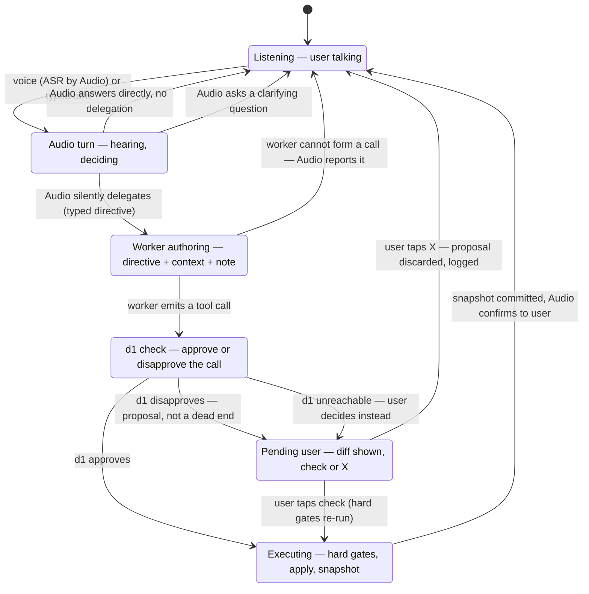

# LiquidScribe — Corrected Design Spec (Audio-First)

- **Status:** Authoritative design spec, 2026-11-09. Source: the project owner,
  stated in his own words on 2026-11-08/09 after the shipped build was found to
  diverge from the intent.
- **Supersedes:** the architecture descriptions in `README.md`, `plan.md` §1–§6,
  and the three `docs/live-edit-*.md` diagrams, wherever they conflict. Those
  documents described a **supervisor-first** pipeline (d1-Omni + a deterministic
  layer route and pre-author content; Audio chats only when nothing is edited).
  That pipeline was what the code implemented when this spec was written — and it is
  **not** this design; the §12 refactor has since landed (see Implementation
  status). `plan.md` §9–§10 remain valid as
  historical records of the shipped build (`docs/repository-audit.md` was
  removed on 2026-11-09 and its findings filed as issues).
- **Implementation status:** the §12 delta has landed on `main` (the supervisor
  pipeline, `supervisor.ts` and the `OMNI_FIRST` flag were deleted 2026-11-09;
  the Audio-first turn loop is the default `audio` run mode; pending-edit
  adjudication, the worker packet and the hard-gate engine are in place). What
  remains is acceptance: the §13 QA battery is not yet green.
- **Implementation plan:** the phased refactor plan
  (`architecture-refactor.md`) was removed on 2026-11-09 and its items filed as
  GitHub issues. Two of its recorded decisions refined this spec: D2's
  `frame_extract` directive field died with the text-only decision below, and
  D3's answer to Q5 — pending edits persist across reloads — is implemented.
- **2026-11-10 decision — Audio-first, text-only.** The front-door model is
  LFM3-Audio-2B (:8086); LFM3-Omni-2B (:8083) is the legacy path. All turns
  are text-only: no frame is resolved or attached, `extract_visual_to_note`
  is removed from the tool contract (3 tools), and the d1 packet carries no
  image. Where this spec says "Omni", read the Audio front door unless a
  legacy `omni` run mode is named.
- **2026-11-11 change — d1 routes the audio turn.** In the default `audio` run
  mode the front door answers in plain chat (tools disabled) and d1-Omni (:8085)
  routes the turn: an edit intent at/above the confidence threshold goes to the
  worker as a harness-built directive (`instruction` is the verbatim command;
  the worker grounds the span). Ambiguity and low confidence never route, and
  there is still no deterministic pre-router — d1 routes *after* Audio has
  answered, so §2.1 stands. On this path the spec's "d1 is a safety check and
  nothing else" statements (§1, §2.4, §3's d1 row) and the Audio-authored
  delegation (§2.2, §4's "silently delegates" edge, §5's emission mechanism)
  apply only to the legacy `omni` run mode. The §7 check grew to five typed
  questions —
  `intent_clarity`, `target_support` and `execution_confidence` join the
  original two — and approval requires all five to pass. Evidence:
  `src/lib/d1route.ts`, `src/lib/flow/omniFlow.ts`, commits 358c428, f280645,
  3821d5e (all merged to `main` 2026-11-11).

---

## 1. The idea

The user talks naturally to **one model: LFM3-Audio-2B**.
Audio is the only model the user ever converses with. It listens,
answers, and, when the note needs to change, **silently delegates** the work to
the LFM3-1.7B worker — the way a primary agent spawns a subagent with a tool
call. The delegation is a typed directive, not a transcript dump.

The **worker authors the edit**: given Audio's directive and a bounded amount of
conversational context, it decides what the new text is and emits the tool call
(`add_text`, `edit_text`, `remove_text`).

**d1-Omni-2B is a safety check, and nothing else.** Before a worker tool call
executes, d1 receives the directive, a bounded context packet,
and the proposed call, and answers one question: is this
call a correct and safe execution of that directive? Approve → the call
executes. Disapprove → **the call does not die**: the proposed edit is shown in
the UI as a diff with the reason, and the **user adjudicates** with a ✓ / ✗.
The user, not the decision model, has the final word on a semantic veto.

Deterministic code is plumbing and hard safety gates — parsing, schema and
anchor validation, the execution engine, snapshots. It **never authors
content, never routes intent, and never substitutes for a model.** If a model
is down, the affected capability degrades honestly (the turn ends, or the edit
goes to the user as a pending proposal); nothing silently fakes the model's
part.

## 2. Principles

1. **Audio-first.** Every turn — chat, command, mixed — goes to Audio first.
   There is no pre-router in front of it, deterministic or otherwise.
2. **Delegation is a tool call.** Audio delegates the way agents spawn
   subagents: a structured call, intercepted by the harness, never rendered
   as user-visible text and never spoken.
3. **The worker authors.** Content originates in exactly two places: the user
   (dictated text) and the worker (generated text). Audio directs; it does not
   write the note. No other component writes prose.
4. **d1 judges, it does not steer.** d1 does not route, ground, or pick tools.
   It evaluates a finished proposal against the directive. One job, tight
   inputs, calibrated outputs.
5. **The user is the court of appeal.** A semantic rejection by d1 is advice
   with a diff attached. The user can overrule it. Hard physical failures
   (broken anchor, out-of-bounds range) are not overrulable — those calls
   cannot be applied safely by anyone.
6. **Context flows downhill, distilled.** Audio holds the conversation. Each
   stage below it receives *less raw chat and more structure* than the stage
   above (see §6). Nobody downstream re-reads the whole transcript.
7. **Runtime honesty (retained from the shipped build).** Every stage records
   whether it ran live or degraded, and the UI says so. No fabricated
   probabilities, no template output labelled as a model call.

## 3. Roles

| Actor | Owns | Must never |
| :-- | :-- | :-- |
| **User** | Conversation, final adjudication of d1-rejected edits | — |
| **LFM3-Audio-2B** (:8086) | ASR, TTS, the conversation, the delegate-or-answer decision, the typed directive, clarification questions, completion confirmations | Write note content itself; emit delegation markup as visible/spoken text |
| **LFM3-Omni-2B** (:8083, legacy `omni` run mode) | Same front-door role on the legacy path | Same |
| **LFM3-1.7B** (:8080) | Authoring edits, choosing the tool, grounding its own target span (line numbers + exact anchor), the XML tool call | Execute anything; see the raw full transcript |
| **d1-Omni-2B** (:8085) | The approve/disapprove verdict on a proposed call, via zero-output-token typed questions over `/v1/systemone` | Route turns, pick tools, ground spans, author or edit content |
| **Deterministic harness** | Directive/call parsing and repair, context-packet assembly, hard gates, execution, snapshots, the pending-edit store | Route intent, author content, invent "fallback" prose or templates |
| **UI** | Conversation, delegation cards, the note, pending-edit cards (diff + ✓ / ✗), traces | Present deterministic output as model output |

## 4. The flow



Step by step:

1. **Input.** Typed text, or a 16 kHz WAV transcribed by Audio
   (`/v1/audio/transcriptions`). No frame is resolved or attached — every
   turn is text-only.
2. **Audio turn.** Audio receives the conversation and
   the note state per §6. It either answers, asks a clarification, or
   delegates — exactly one of the three.
3. **Delegation.** The harness intercepts the delegation call, opens a
   delegation card in the UI (tool, one-line intent — the pipeline is visible,
   the markup is not), and assembles the worker packet (§6).
4. **Worker.** The worker reads the directive, the context packet and the
   line-numbered note; authors the content; grounds its own span; emits one
   XML tool call. Two malformed attempts → the turn fails honestly via Audio;
   there is no content-authoring fallback.
5. **d1 check.** The harness runs the hard gates (§8) first — a call that
   fails them never reaches d1. Then d1 judges the surviving call (§7, text-only packet).
6. **Outcome.** Approved → execute. Disapproved or d1 unreachable → pending
   edit (§9). Executed edits push a snapshot; Audio receives the execution
   result as a system event and confirms in its own words.
7. **Undo/redo.** Snapshot rollback is a user instruction Audio maps to a
   harness action, not a worker task; it bypasses worker and d1 entirely
   (retained from the shipped build).

## 5. The directive (Audio → worker)

The directive is the contract of the whole design. It is **typed, minimal, and
context-resolved**: Audio heard the conversation, so references the user made
("the same for Q4", "that bullet") are resolved *inside the directive* — the
worker should rarely need the context packet to know what was meant; the
packet is corroboration, not the primary channel.

```jsonc
{
  "task": "create",            // create | insert | edit | remove (the 2026-11-10
                               // text-only decision removed extract)
  "instruction": "Write a README template document to begin the note: title it README and give it the standard sections — overview, getting started, usage, contributing, license. The note currently holds a Q3 review; the user wants the template at the top.",
  "target": {                  // optional; the worker grounds the exact span
    "description": "top of the note, before the Q3 Business Review heading",
    "heading": null
  },
  "verbatim": null,            // exact user-dictated text, when the user dictated it; otherwise null
  "constraints": ["markdown", "keep the existing Q3 content intact"],
}
```

Rules:

- `instruction` is a **brief, not the content** — except that Audio must pack
  into it everything the user specified about the content (sections named,
  values given, tone asked for). "Write a README template document" as the
  whole instruction is a malformed directive; the example above is the bar.
- `verbatim` is the one case where content legitimately travels inside the
  directive: the user dictated exact words. The worker inserts them as-is.
- Emission mechanism: Audio is served by llama.cpp with tool support
  (`--jinja`); the delegation is a tool/function call in its completion,
  parsed and schema-validated by the harness. Validation failure → one repair
  retry with the schema error appended → Audio falls back to a clarifying
  question, never to prose that pretends to be an edit. *(Open question Q1,
  §14: confirm Audio's tool-call reliability on the local build; if a native
  tool call proves unreliable, the fallback mechanism is a delimited
  structured block in the completion, intercepted the same way. The contract
  — typed, invisible, validated — is identical either way.)*
- A directive is per-turn and ephemeral; it is recorded in the trace.

## 6. Context policy

The owner's open question — *should the worker get previous turns?* — resolves
as follows: **yes, but as outcomes, not transcript.** Raw turns dilute a small
worker's attention, let stale instructions compete with the current directive,
and invite it to imitate conversation instead of executing. But zero context
breaks follow-ups ("make it shorter", "add one like the last"). Distillation
gets both.

| Consumer | Packet | Budget |
| :-- | :-- | :-- |
| **Audio** | Rolling conversation (recent turns), the note: full text when the turn is about the note, outline (title + headings) otherwise | Existing chat discipline; note cap may rise above the shipped 3,600 chars — Audio has the context and prefix caching absorbs repeats (Q3) |
| **Worker** | The directive + **context packet**: the last **3 completed edit turns**, each as `{user command, directive summary, diff summary}` — no assistant prose, no chat — + the **full line-numbered note** (it authors and grounds; a ±3-line window is a shipped-build defect, §12) | Packet ≤ ~600 tokens; note full at current scale, window-expansion rules only if the note outgrows the worker's context |
| **d1** | The directive + the user's current command verbatim + the proposed call + its rendered diff + **at most the last user turn** (no image — text-only) | Tightest packet in the system; d1 is a calibrated decision head and its accuracy degrades on long context — it judges call↔directive fit, not conversation history |

Deterministic assembly: the harness builds these packets from recorded turns
and diffs (it already records both). Assembly is transformation, not
authorship — it selects and formats, it does not summarize in prose. The
directive summaries in the packet are the directives themselves, truncated.

## 7. The d1 check

After the hard gates (§8) pass, d1 receives its packet (§6) and answers typed
questions over `/v1/systemone` — the existing bridge supports `noul`, `choice`
and `score`:

1. `does_call_match_directive` (`noul`): does this call do what the directive
   asked — right operation, right target, content that matches the brief?
2. `destructive_safety` (`choice`: `safe` | `unintended_data_loss`): does the
   call delete or overwrite anything the directive did not ask to touch?

Verdict policy:

- **Approve:** `noul ≥ 0.5` and `destructive_safety = safe`.
- **Disapprove:** otherwise. The verdict, both scores, and the failing
  question travel with the pending edit so the user sees *why*.
- **d1 unreachable / malformed answer:** not an approval and not a rejection —
  the edit goes to the user as a pending proposal marked "d1 unavailable".
  Silence from the safety model must neither rubber-stamp nor dead-end a run.
- Thresholds are starting values, to be calibrated against the QA battery and
  real use (Q2, §14); they live in one place, not scattered per-call-site as
  in the shipped build.

d1 does not get a retry loop and does not talk back to the worker: a
disapproved call is finished as a worker attempt. The user's ✓ is the only
appeal.

## 8. Hard gates (deterministic, non-overridable)

Run before d1, and **re-run on user approval** of a pending edit, against the
*current* note:

- Schema validity: known tool, all required parameters present and typed.
- Range bounds: `1 ≤ start_line ≤ end_line ≤ line_count`.
- Anchor exactness: `old_text_anchor` / `target_excerpt` must match the
  current lines at the stated range, whitespace-normalized.
- Note version: the call was authored against a recorded note hash; if the
  note changed since, anchor exactness is what decides — a drifted anchor
  fails the gate and the pending edit is marked **stale** (§9).
- Blast radius: a `remove_text` (or an `edit_text` that collapses a span)
  beyond the established cap fails the gate. Unlike the shipped build, this
  check lives **in the execution engine as well as the pre-check**, so no
  caller of `executeTool` can bypass it.

A hard-gate failure is never shown as a ✓ / ✗ choice. The edit is returned to
the user as an explanation ("the text this edit was written against has
changed"), with the option to ask Audio to redo it.

## 9. Pending edits — user adjudication

A pending edit is a first-class, stored object:

```jsonc
{
  "id": "…",
  "created_at": "…",
  "directive": { /* §5 */ },
  "call": { /* the worker's XML tool call, parsed */ },
  "diff": { /* rendered against the note version below */ },
  "note_hash": "…",            // note version the call was authored against
  "d1": { "verdict": "disapproved" | "unavailable", "noul": 0.31,
          "destructive_safety": "safe", "reason": "…" },
  "status": "pending"          // pending | applied | discarded | stale
}
```

UI contract:

- The pending edit appears as a card in the session **and** as an inline diff
  in the note. It shows: the diff, the worker's tool, d1's verdict and scores,
  and one line of "what was asked" (the directive's `instruction`).
- **✓ applies:** hard gates re-run (§8); pass → execute, snapshot, card
  resolves to *applied*, Audio confirms. Fail → card resolves to *stale* with
  the reason; nothing is written.
- **✗ discards:** nothing is written; the proposal (directive, call, verdict)
  is appended to the rejected-traces log — the same JSONL the shipped build
  already exports, which is also the future fine-tuning dataset.
- Pending edits queue in arrival order; a new turn does not silently clear
  them. Voice adjudication ("yes, apply it" / "no, drop it") is an Audio →
  harness action on the oldest pending edit, stated explicitly by Audio before
  it takes effect.
- A pending edit is not a snapshot and does not modify the note, the history
  stack, or the undo chain until applied.

## 10. Conversation behaviour

- **Silent delegation.** The user experiences: they ask, a delegation card
  appears, the note updates, Audio confirms. Audio does not narrate pipeline
  internals, probabilities, or stage names in chat or speech.
- **Acknowledgements** for slow worker turns are Audio's own ("On it — writing
  that now" in its voice), generated by Audio, not canned harness strings.
  (Shipped-build defect: acknowledgements and completion messages are
  templates, §12.)
- **Clarification** is Audio's move, made *before* delegating, when a directive
  cannot be formed responsibly — not a harness clarification generated from a
  failed regex plan.
- **Confirmations** are spoken/shown by Audio from the execution result the
  harness hands back (tool, diff summary, snapshot label) — facts from the
  harness, words from Audio.

## 11. Failure and degradation

| Failure | Behaviour |
| :-- | :-- |
| Audio down | No conversation, no delegation: the app is its interface. UI shows the endpoint down (Runtime truth). Typed input is held, not "handled" by a fallback brain. ASR/TTS unavailable with it. |
| Worker down / two malformed calls | Audio tells the user the edit could not be made. No template call is fabricated. The directive is kept in the trace so the turn can be retried. |
| d1 down | Edits route to pending-user (§7). The app keeps working at a lower assurance level, labelled as such. |
| Hard-gate failure | Edit returned with explanation; never a ✓ / ✗ (§8). |

The one deterministic construction that survives: **verbatim dictation**. When
the user's command carries exact quoted text to insert, the harness may build
the `add_text` call directly — the content is the *user's*, so no model
authorship is being faked. The trace labels it `dictation`, never a model
call, and it still passes the hard gates and d1 (or pending-user) like any
other call.

## 12. Delta from the shipped build

What has to change in the code on `main`, by file. This section is the
refactor's scope; everything not listed (execution engine, snapshot stack,
XML contract, bridge endpoints, VAD/ASR capture, UI shell) is retained.

| Shipped behaviour | Location | Required change |
| :-- | :-- | :-- |
| d1 + heuristic route **before** Audio; mutation turns never reach Audio | `src/state/useWorkspace.ts` (`submitCommand`) | Audio-first turn loop (§4); routing deleted as a stage |
| Audio prompt forbids acting and caps it at handoff sentences; 500-token chat budget | `useWorkspace.ts` (`buildChatMessages`) | Prompt rewritten around answer / clarify / delegate; budget and sampling revisited (Q3) |
| Audio served `--reasoning off --temp 0` | `scripts/start-models.sh` | Serving flags revisited with the prompt work (Q3) |
| Regex layer authors content: `extractAddContent`, `semanticAddContent` (3 hardcoded topics), `buildDocumentTemplate` (one skeleton for every document kind, and only on a literally empty note) | `src/lib/supervisor.ts` (`buildPlan`) | Deleted as authors. `buildPlan` ceases to exist; grounding and content move to the worker |
| Worker told to insert supervisor content **verbatim**, given **1 tool schema** and a **span ±3 lines** note window ("full file withheld") | `src/lib/worker.ts` (`buildWorkerMessages`, `WORKER_SYSTEM_PROMPT`), `supervisor.ts` (`tokenViewForWorker`) | Worker packet per §6: directive + context packet + full line-numbered note + full tool catalog (or d1-free, worker-chosen tool) |
| Live worker calls that diverge from the supervisor's span/tool are discarded or overwritten by the deterministic template call | `useWorkspace.ts` (worker attempt loop) | Deleted. The worker's call is the proposal; divergence from a harness guess is not an error class |
| d1 also routes and grounds | `supervisor.ts` (`ROUTE_QUESTIONS`, `resolveGroundingSpan`), `useWorkspace.ts` | d1 reduced to §7's check; routing/grounding questions deleted |
| Critic packet has no directive, no turns | `useWorkspace.ts` (`buildCriticState`, `CRITIC_QUESTIONS`) | Packet per §6/§7 (text-only) |
| Critic rejection = dead end, generic message, note untouched | `useWorkspace.ts` (rejection path) | Pending-edit store + adjudication UI (§9) |
| Acknowledgements / completions are canned templates | `useWorkspace.ts` (`ackFor`, `completionFor`) | Generated by Audio from harness facts (§10) |
| Blast-radius check exists only in the supervisor critique, not in `executeTool` | `src/lib/supervisor.ts`, `src/lib/tools.ts` | Moved/duplicated into the engine (§8); known hole from the 2026-11-08 audit |

## 13. Acceptance criteria

The refactor is done when the QA battery (extended, §13 cases in
`scripts/qa-suite.mjs`) passes against the live trinity:

1. **The README case.** On the seed note **and** on a `# Untitled` new note:
   "write a README template document to begin" produces a real multi-section
   README (title + at least the standard sections), authored by the worker —
   the literal phrase "README template document" appears nowhere as inserted
   content, and the trace shows an Audio directive and a worker call with no
   deterministic content stage.
2. **Follow-up context.** "Update the Q3 revenue row to $1.45M Final" then
   "do the same for Q4 to $1.5M" — the second edit lands correctly from the
   context packet.
3. **d1 adjudication.** A call the battery forces d1 to disapprove appears as
   a pending edit; ✓ applies it (snapshot pushed), and in a second run ✗
   leaves the note byte-identical and appends the rejected trace.
4. **Staleness.** A pending edit whose target lines are changed by a source
   edit before adjudication resolves to *stale* on ✓ and writes nothing.
5. **d1 down.** With :8085 stopped, an edit arrives as pending ("d1
   unavailable") rather than executing or dying.
6. **Delegation hygiene.** No delegation markup, XML, or pipeline vocabulary
   appears in the chat transcript or TTS text on any case; delegation cards
   show tool + intent.
7. **Dictation exception.** A quoted-dictation insert is traced as
   `dictation`, executes verbatim, and is never labelled a model call.
8. All pre-existing battery cases that do not encode supervisor-first
   behaviour still pass; cases that *do* encode it are rewritten to this spec,
   not deleted silently.

## 14. Open questions

- **Q1 — Directive emission.** Native tool calling vs. delimited structured
  block for Audio's delegation (§5). Decide by experiment on the local
  llama.cpp build before the refactor's worker work starts.
- **Q2 — d1 thresholds.** §7's starting values need calibration runs against
  the battery's destructive cases (the shipped 12c blast-radius case is the
  floor: it must never auto-approve).
- **Q3 — Audio budget and serving flags.** Chat max-tokens, note cap,
  temperature, and the `--reasoning off` server flag: tune together, since
  the delegate-or-answer decision is Audio's core skill in this design.

Q4 and Q5 were filed as GitHub Issue #50 on 2026-11-09.
