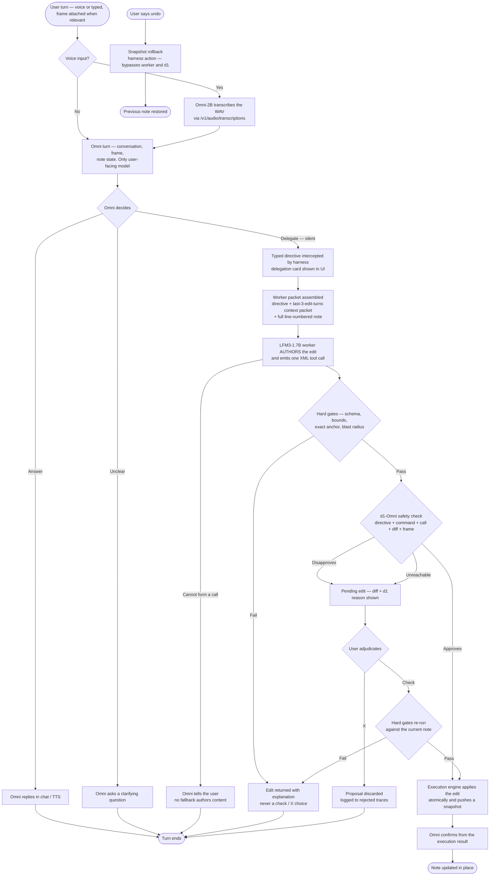

# Live-edit — command flowchart (corrected design, 2026-11-09)

Decision-flow view of one live-edit command **under the corrected Omni-first
design in [`design.md`](./design.md)**: the user talks to Omni, Omni answers or
silently delegates a typed directive to the 1.7B worker, the worker authors the
tool call, hard gates and then d1 check it, and a d1 disapproval becomes a
pending edit the user adjudicates — plus the model-free undo lane. This
supersedes the 2026-11-08 flowchart of the shipped supervisor-first pipeline
(d1 routing, deterministic span/content authoring). Mermaid flowchart,
validated with `mermaid.parse()` (Mermaid 11, diagram type: flowchart-v2) on
2026-11-09. The target design is **not yet implemented** (design.md §12).

