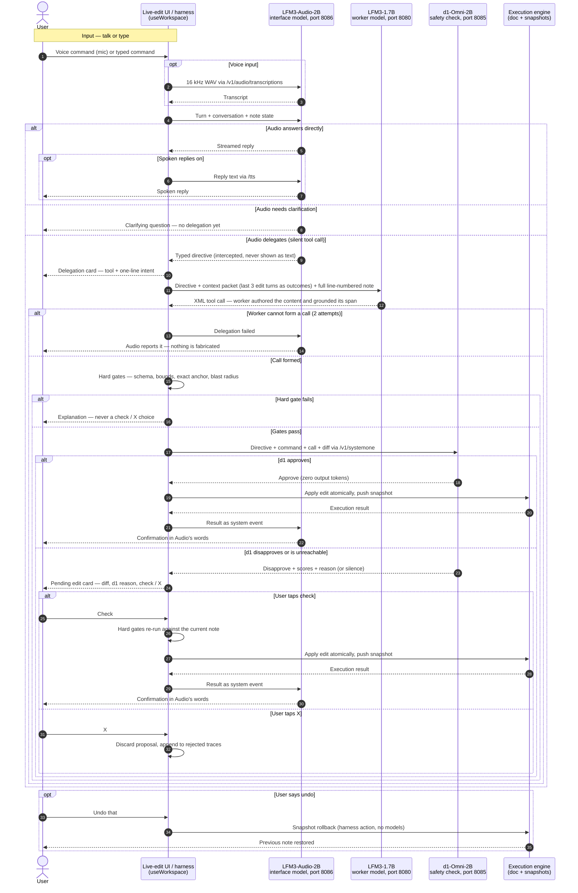

# Live-edit — user and model interaction diagram (corrected design, 2026-11-09)

How a turn travels from the user to Audio, and — when Audio delegates — to the
1.7B worker and the d1 safety check, **under the corrected Audio-first design
in [`design.md`](./design.md)** (interface model: LFM3-Audio-2B :8086; the
2026-11-10 decision made Audio the default front door — turns are text-only,
no camera or screen frames). Sequence diagram in Mermaid, validated with
`mermaid.parse()` (Mermaid 11, diagram type: sequence) on 2026-11-09. This
supersedes the 2026-11-08 diagram of the shipped supervisor-first pipeline:
there is no supervisor participant in this design — the harness is plumbing
(parsing, packets, hard gates, execution), and it never routes intent or
authors content. The target design is **not yet implemented** (design.md §12).

