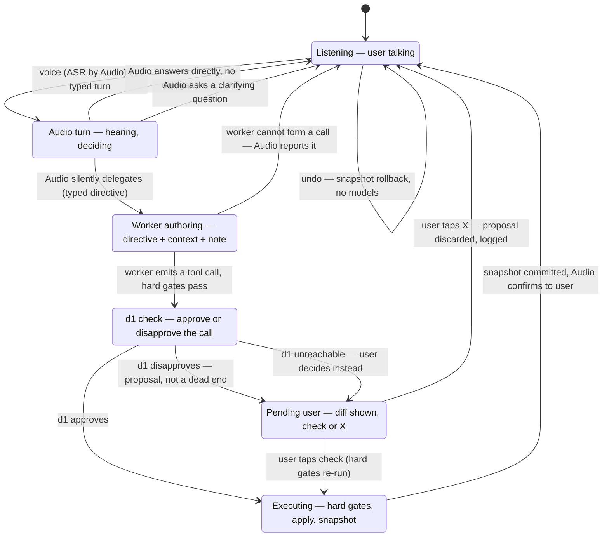

# Live-edit — turn state diagram (corrected design, 2026-11-09)

State view of a live-edit turn **under the corrected Audio-first design in
[`design.md`](./design.md)**: the workspace sits in Listening, every turn goes
to Audio, and a turn either resolves in Audio (answer, clarification), or flows
through silent delegation to the worker, the hard gates and the d1 check, and
— on disapproval — the PendingUser state, where the user adjudicates with
✓ / ✗. Snapshot rollback is a harness action with no model in the loop. This
supersedes the 2026-11-08 state diagram of the shipped supervisor-first
pipeline (Routing / Grounding / Critic gate states). Mermaid stateDiagram-v2,
validated with `mermaid.parse()` (Mermaid 11, diagram type: stateDiagram) on
2026-11-09. The target design is **not yet implemented** (design.md §12).

