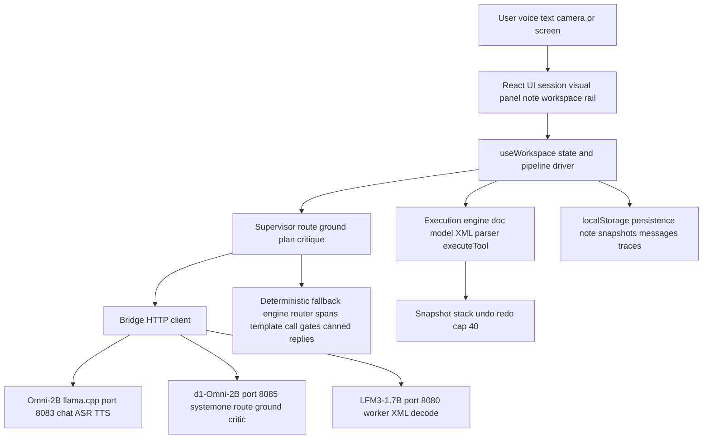

# live-edit — Comprehensive Repository Audit

> **Post-audit note (2026-11-09) — read before citing the architecture sections.**
> This audit is a point-in-time record of commit `d84a0ab`; its findings stand as
> written and are not revised here. But its architectural premise needs one
> correction the audit could not have made: the supervisor-first pipeline it
> describes (d1 routing/grounding, deterministic content authoring, Omni as
> chat-only) is **not the owner's design**. The owner stated the intended design
> on 2026-11-09 — Omni-first delegation, a worker that authors edits, d1 as a
> safety check only, and user adjudication of d1 rejections — and it is now the
> authoritative spec in [`design.md`](./design.md) (§12 there maps this audit's
> code locations to the refactor delta). Where this report evaluates the
> pipeline *as a supervisor design*, design.md supersedes the framing; where it
> reports code facts and defects, it remains the record.

- **Repository:** [github.com/Theblackcat98/live-edit](https://github.com/Theblackcat98/live-edit) (public)
- **Branch:** `main`
- **Audited commit:** `d84a0ab3aceb56324f3c8fbf585f1475323552cf`
- **Audit date:** 2026-11-08
- **Audit type:** architecture, features, functionality, security, reliability, and technical-debt audit — evidence-based, read-only on application code. The only file created is this report.
- **Method:** four parallel section auditors (orchestration core; document engine / tools / speech / persistence; UI / presentation; QA / build / docs), each reading every file in its scope in full, tracing features end-to-end (UI → state → supervisor → bridge → model servers / fallback engine → persistence), and running behavioural probes against the real modules where the environment allowed. The QA auditor owned all toolchain runs. The orchestrator independently spot-checked the fabricated-probability sites in `src/lib/supervisor.ts` and triangulated the blast-radius hole across three auditors (see §15).
- **Raw findings:** 71 (LECORE 20, LEDOC 19, LEUI 18, LEQA 14) — 0 Critical, 8 High, 32 Medium, 31 Low — consolidated by root cause into **46 items** (TD-01…TD-46, §8). Every raw finding ID appears as a source reference in §8, §9, or §10.
- **Verification environment caveat:** this VM has no model servers, no GGUFs, no llama.cpp build, and no PulseAudio tooling. Everything that depends on a live LFM3 trinity is therefore classified **Unverified** in this audit, however convincing the code reads. The deterministic fallback engine, by contrast, was actually run (see §7).

---

## 1. Executive Summary

live-edit is a local-first, multimodal note workspace: a Vite + React 19 + TypeScript single-page app that lets a user edit a Markdown note by voice or text, supervised by three local llama.cpp servers running the LFM3 family — LFM2.5/LFM3 Omni-2B on :8083 (chat, ASR, TTS), d1-Omni-2B on :8085 (routing, grounding, and critic verdicts via zero-output-token `/v1/systemone` heads), and LFM3-1.7B on :8080 (an XML tool-call worker) — with a deterministic fallback engine that keeps the full pipeline working when every server is down, and a snapshot stack that makes every mutation undoable.

**The central finding is about the app's own stated design principle.** The product's differentiator, stated in the README's "Runtime honesty" section, is that *nothing silently fakes a model call*: every stage records whether it ran live or fell back, and the UI is supposed to say so. The audit's verdict is that this principle is **genuinely implemented in the architecture and genuinely broken in the presentation layer** — in specific, enumerable, fixable places:

- The decision traces record per-run runtime honestly; the trace drawer is truthful about which path each stage took.
- But fallback routing and critic "probabilities" are partly **fabricated with `Math.random()`** and rendered to two decimal places as if measured — and the critic's verdict gate consumes two of those rolled values (LEUI-2 / LECORE-03).
- The always-visible **Runtime truth rail derives LIVE/FALLBACK from endpoint up/down probes**, not from per-run runtime — a stage that fell back while its server was up still reads LIVE (LEUI-1).
- When the 1.7B worker is unavailable, the deterministic template call executes — and the in-chat delegation card still says **"1.7B · tool call"**, complete with a fabricated first-person "thought" written in the worker's voice (LECORE-02).
- When d1 omits a probability distribution, grounding **assumes p = 0.6**, which clears the "decisive" gate (≥ 0.5) that lets d1 overturn a deterministic miss, and writes "p 0.60" into the trace as a real score (LECORE-04).
- Locally composed template replies are revealed with a **typewriter animation indistinguishable from real model streaming** (LEUI-4).

None of this requires a redesign. The honest machinery already exists — the trace's runtime map, the supervisor-override path that correctly relabels its delegation card, the fail-closed d1 critic overlay. The Phase 0 roadmap (§13) is a labelling-and-gating pass, not new architecture.

**The second headline is an integrity hole, triangulated independently by three auditors.** The critic's `target_grounded` gate never bounds the tool call's *end line* against the grounded span, and its `anchor_exact` check is self-referential (LECORE-01). The blast-radius check that is supposed to catch over-broad edits lives only in the supervisor's `critique()`, not in the execution engine — `executeTool` called directly deletes 12 of 13 lines and reports success (LEDOC-05). And the QA battery, run in the only configuration available off the author's workstation (no model servers), **verified** the exact edit — "Replace the Risks section with tiny" — that the docs say the blast-radius gate rejects (LEQA-02, case 12c). With the trinity up, the README's critic-hold example genuinely rejects via `blast_radius` (probe-verified by the core auditor); without models, the safety story has a hole in it.

**What is already solid** (do not break these while fixing the above):

- The deterministic fallback engine works end-to-end: 24 of 33 QA cases pass with **no model servers at all**, including typed edits, undo/redo, templates, clarification, and persistence — with zero page exceptions.
- Traces record per-run runtime honestly; the trace drawer is the truthful surface in the app.
- The d1 semantic critic is a fail-closed overlay: it runs only after local gates pass, rejects only on a low `noul` score, and a d1 outage can neither approve what local gates rejected nor block on its own silence.
- The VAD claims are literally true in code (floor-adaptive gate `max(0.004, 2.2×floor)`, 1.2 s trailing stop); the WAV encoder's header math and peak-safe gain are correct.
- No audio or frame data is persisted; visual extraction inserts are model-free by design and disclosed as such in the README; the LFM3-VL-2B removal is complete (no code path references it).
- Mutations are computed from an immutable note snapshot and committed only after critic verification **and** successful execution; undo/redo and busy discipline are correctly guarded.
- The mundane toolchain is genuinely green: install, strict typecheck, and production build all pass on the declared (unusually new) dependency versions.

**Overall:** a remarkably complete single-day-prototype-turned-workstation-tool whose engine is more honest than its UI. It is suitable today as a research demo and a personal workstation tool. It is not suitable for anything beyond that until the Phase 0 integrity/honesty items land — and its entire verification story currently lives on one machine (no CI, no unit tests, a QA battery that cannot run anywhere else).

---

## 2. Repository Overview

| | |
|---|---|
| Purpose | Local-first multimodal note editing: voice/text commands are routed, grounded to a note span, turned into one XML tool call, critiqued, and executed against a snapshot-versioned Markdown note, with a live visual context panel (synthetic slide, camera, or screen). |
| Form factor | Browser SPA (no backend of its own). All inference is delegated to three user-run llama.cpp servers on localhost ports 8080 / 8083 / 8085. |
| Stack | Vite 8.3.6, React 19.3.1, TypeScript 7.0.2 (strict), KaTeX for math rendering, lucide-react icons, @fontsource-variable/inter. No router, no state library — one 2,037-line `useWorkspace` hook is the state layer. |
| Size | 63 tracked files; ~17k LOC of TypeScript/TSX in `src/` plus ~6.2k lines of CSS across 9 files; two QA/model scripts totalling ~2.1k lines. |
| History | 13 commits, all on 2026-11-08, single branch (`main`), no tags or releases. Commit messages carry the QA case counts of their moment (29 → 31 → 33), which makes later doc drift provable. |
| Governance | No CI, no LICENSE, no GitHub issues or PRs (zero of either), no unit tests, no lint. |

### The name tangle (documentation finding)

This project has three identities, and one of them collides with a different repository:

- The **repository** is `live-edit`.
- The **package** is `"liquidscribe"` v0.9.0 (`package.json`) — the same name as the separate, unrelated Next.js + Tiptap + Postgres repo `Theblackcat98/liquidscribe`. The QA suite's localStorage key (`liquidscribe.workspace.v1`) inherits the collision, so tooling that keys off the package name cannot distinguish the two codebases.
- The committed **lockfile** identifies a third thing: `"live-edit"` v1.0.0, license ISC (`package-lock.json` root entry) — generated before a rename and never regenerated, so a routine `npm install` rewrites 39 lines of tracked lockfile (LEQA-03).
- The **UI** brands itself "LiquidScribe" (`index.html` title).

This is recorded as consolidated item TD-30 (§8) and in the docs reconciliation (§11). It is not merely cosmetic: this audit series covers both repos, and the shared package name is a standing invitation to file work against the wrong codebase.

### What the app is *not*

There is no server-side component, no account system, no stored credentials, no telemetry, and no network egress except to the three localhost model servers the user starts themselves. Several security expectations for a web app therefore do not apply; §9 states this explicitly rather than padding the findings.

---

## 3. Repository File Inventory and Audit Coverage

63 tracked files, classified (from the LEQA inventory; every file was read by at least one auditor):

| Category | Count | Contents |
|---|---|---|
| Application source (`src/`) | 47 | 18 components, 11 lib modules, 4 data modules, 1 state hook (`src/state/useWorkspace.ts`, 2,037 lines), `App.tsx`, `main.tsx`, `types.ts`, `vite-env.d.ts` |
| Styles (inside `src/styles/`) | 9 files | tokens / layout / visual / session / document / rail / trace / about / responsive — 6,153 lines total |
| Scripts | 4 | `scripts/qa-suite.mjs` (850 lines), `scripts/hardware-voice-check.mjs` (1,157), `scripts/start-models.sh` (103), `scripts/stop-models.sh` (20) |
| Documentation | 3 | `README.md` (164 lines), `TODO.md` (92), `plan.md` (574) |
| Config / build | 8 | `package.json`, `package-lock.json`, `tsconfig.json`, `tsconfig.app.json`, `tsconfig.node.json`, `vite.config.ts`, `index.html`, `.gitignore` |
| Assets | 1 | `public/favicon.svg` (316 B, referenced by `index.html`) |

Coverage notes:

- **No orphaned code:** an import sweep confirms every file under `src/components`, `src/lib`, and `src/data` is imported by at least one other project file. (Dead *exports* inside live files are a separate matter — LEDOC-16.)
- **No tracked binaries or large files.** Largest: `useWorkspace.ts` (72 KB), `supervisor.ts` (69 KB), `hardware-voice-check.mjs` (47 KB), `package-lock.json` (43 KB). Fonts arrive via npm (`@fontsource`), not the repo.
- **Excluded from detailed review:** nothing project-owned was excluded. `node_modules` and `dist` are untracked and were inspected only as build outputs.
- **Could not be inspected at runtime:** the live-model paths (no servers on the audit VM), the hardware audio path (no PulseAudio tools), and the phone surface in a real browser (read from CSS/code only). See §15 for the full limits list.

Key files by role:

| File | Role | Lines |
|---|---|---|
| `src/lib/supervisor.ts` | Routing, grounding, plan building, critic gates, fallback replies | 1,915 |
| `src/state/useWorkspace.ts` | All workspace state, pipeline orchestration, persistence wiring, ASR/TTS hand-off | 2,037 |
| `src/lib/bridge.ts` | HTTP client for the three llama.cpp servers (chat, systemone, ASR, TTS, health) | ~470 |
| `src/lib/worker.ts` | Worker prompt construction, template tool-call emitter, XML serialization | ~210 |
| `src/lib/tools.ts` | The execution engine (`executeTool`) for the 4 tools | ~220 |
| `src/lib/doc.ts` / `xml.ts` / `speech.ts` / `frame.ts` / `storage.ts` | Markdown model, XML parser, voice capture/VAD/WAV, frame resolution/cropping, localStorage persistence | — |
| `src/components/*` (18) | Session panel, visual panel, note workspace, runtime rail, trace drawer, dialogs | — |

---

## 4. Architecture and System Design

### Subsystems

1. **Presentation (`src/components/`, `src/App.tsx`).** Four surfaces: the session column (transcript, composer, guided demo, suggestion chips), the visual panel (synthetic slide / live camera / screen, ROI overlay, waveform), the note workspace (rendered Markdown document + raw source editor + snapshot rail), and the right rail (model roster, Runtime truth card, supervisor stages, context budgets) plus the trace drawer and About dialog. Components are presentational; almost all state lives in one hook.
2. **State / orchestration (`src/state/useWorkspace.ts`).** The single state layer and pipeline driver: command submission, routing hand-off, grounding retries, worker attempts, critic invocation, execution, snapshot commits, chat streaming, ASR/TTS, demo sequencing, toasts, and the debounced persistence effect.
3. **Supervisor (`src/lib/supervisor.ts`).** The deterministic brain: command normalization, the local router, span grounding (literal pre-empts, keyword search, d1 typed choice), plan building, the deterministic critic gates, fallback conversational replies, and clarification construction.
4. **Bridge (`src/lib/bridge.ts`).** The only module that talks to the model servers: health probes (10 s cadence), Omni chat (streaming and non-streaming), d1 `/v1/systemone` decisions, worker chat completions, ASR transcription upload, and Omni TTS. Endpoint health is snapshotted into a ref the pipeline consults per stage.
5. **Worker (`src/lib/worker.ts`).** Builds the worker prompt (primary tool schema only, grounded span/anchor hints, line window) and the deterministic template tool call used when the live decode fails or is unavailable.
6. **Execution engine (`src/lib/doc.ts`, `src/lib/tools.ts`, `src/lib/xml.ts`).** The Markdown block model and heading/section search; the regex XML tool-call parser; and `executeTool`, which splices line ranges for `edit_text` / `remove_text` / `add_text` / `extract_visual_to_note` after range and anchor checks.
7. **Media (`src/lib/speech.ts`, `src/lib/frame.ts`).** Microphone capture with a floor-adaptive VAD, 16 kHz WAV encoding with peak-safe gain; frame resolution with provenance (registered live frame wins; synthetic slide raster is the fallback and is relabelled as such), ROI cropping.
8. **Persistence (`src/lib/storage.ts`).** Version-1 localStorage schema: note, snapshots, messages, up to 12 runs, rejected traces. No audio or frame data is ever persisted.
9. **Model servers (external, user-run).** Three llama.cpp instances started by `scripts/start-models.sh`: Omni-2B :8083, d1-Omni-2B :8085, LFM3-1.7B :8080.

### Data flow — one mutation command

`submitCommand` → local directive pre-pass (undo/redo) → route (live: d1 `systemone` answers; fallback: deterministic router; three deterministic guardrails can override the live route) → `buildPlan` (literal quote/line/ordinal pre-empts, keyword span search) → grounding (structural candidate enumeration, d1 typed span choice with p-gates, retry over alternative tools) → worker (live 1.7B XML decode, up to two attempts, in parallel with constructing the deterministic template call) → supervisor span-replacement if the live call drifted → critic (deterministic gates, then the d1 semantic overlay) → XML re-parse → `executeTool` against the immutable note-at-start → snapshot commit → completion message. Every stage writes its `live | fallback` provenance into the run's trace.

### Architecture diagram

### Architectural assessment

**Strengths.** The layering is real: the bridge is the only network module; the supervisor is pure enough that the core auditor could transpile and probe it in Node; mutations are computed from an immutable `noteAtStart` and committed atomically; the provenance model (`TraceRuntime` per stage) is a genuinely good idea, implemented at the right layer. Health probing is per-stage consulted and per-call failures also fall back, so a flapping server degrades runs rather than breaking them.

**Weaknesses.**

- **Two ~2,000-line files carry the system.** `useWorkspace.ts` (2,037) is simultaneously the store, the pipeline, the ASR/TTS controller, and the persistence layer; `supervisor.ts` (1,915) holds routing, grounding, critic, and canned chat. They are well-organized internally, but every change is a change to a load-bearing monolith, and there are no unit tests to catch regressions (§7).
- **Safety checks live one layer too high.** The blast-radius and span-confinement guarantees are properties of the supervisor's critic, not of the execution engine that performs the splice. Any caller that reaches `executeTool` without `critique()` — or any fallback path where the critic's inputs differ — inherits no protection (LEDOC-05, LECORE-01). Defence in depth is missing exactly where the destructive operations are.
- **The XML contract is a convention, not a format.** Serializer and parser agree to pretend delimiters never appear in content; there is no escaping on either side (LEDOC-02/03). For an app whose job is editing text — including text about markup — the contract syntax is a plausible payload.
- **Provenance has only two values.** `live | fallback` squeezes directives, the deterministic extractor, and supervisor overrides into "fallback", and several UI surfaces re-derive provenance from cruder signals (endpoint health) instead of consuming the trace's map (LEUI-1).
- **Configuration is compiled in.** Model endpoints are constants in `bridge.ts`; changing a port means editing code, `start-models.sh`, and both QA scripts. There is no env configuration anywhere (`import.meta.env` / `process.env` are never read in `src/`).
- **Fixture duplication.** The demo slide exists as DOM (`SceneSlide`), as scene data, as canned extraction Markdown (`VISUAL_MARKDOWN`), as a hardcoded crop miniature (`SceneCrop`), and as a canned conversational description — five hand-synced copies whose drift produces real findings (LEUI-11, LEDOC-12/13).

---

## 5. Complete Feature Inventory

Statuses use this audit's scale: **Working** (implemented, connected, evidence of correct behaviour), **Mostly working** (core works, meaningful limitations), **Partial** (important pieces missing or disconnected), **Broken** (implemented but defects prevent expected behaviour), **Not implemented**, **Unverified** (code exists; the audit environment could not establish that it works — used for every live-model-dependent feature, since no model servers exist on the audit VM), **Deprecated**.

### Live session & chat

| Feature | Description | Implementation | Status | Evidence | Limitations | Priority |
|---|---|---|---|---|---|---|
| Conversational chat (Omni streaming) | Streamed Omni replies with multi-turn memory; image attached only on visual turns | `chatCompleteStream` + output sanitizer; frame gated by a visual-intent regex; abort-aware partial handling | Unverified (live); memory **Partial** | useWorkspace.ts:1220-1330; bridge.ts:228-352 | Current command duplicated into memory and completion templates replayed as assistant turns (LECORE-05) | High |
| Deterministic fallback replies | Pattern-matched answers when Omni is down | Templates with some real computed values (word/token counts, note-derived status) | Partial | supervisor.ts:1793-1860 | Fabricated memory figure and synthetic-slide description presented as observation (LECORE-10) | High |
| Guided demo | Four-command product tour | Scripted commands submitted through the *real* pipeline, stoppable between steps | Working | useWorkspace.ts:1940-1965; data/note.ts:48-53 | Seed-note-specific; TODO's "scripted demo-document sequence" wording is stale — execution is live | Low |
| Suggestion chips | Quick commands derived from the user's actual note | First table row / bullet / heading become draft or submit chips | Mostly working | suggestions.ts:15-59; SessionPanel.tsx:191-214 | 4th chip unreachable — panel slices to 3 (LEUI-16); supervisor ambiguity chips, by contrast, are seed fabrications (LECORE-09) | Low |
| Typewriter / streaming display | Replies feel live | True token streaming for chat; per-character reveal for local template text | Partial | TypewriterText.tsx:18-35 | Template text performs streaming (LEUI-4) | Medium |
| Barge-in / cancel | Interrupt a running pipeline | Chat abort exists only via New chat (destructive) or unmount; worker call takes no AbortSignal; barge-in cuts speech then drops the new command | Not implemented | useWorkspace.ts:944-955, 1903; bridge.ts:191-226 | LECORE-08 / LEUI-9 — a misspecified destructive command cannot be stopped once routing starts | High |

### Voice — ASR & TTS

| Feature | Description | Implementation | Status | Evidence | Limitations | Priority |
|---|---|---|---|---|---|---|
| Voice capture + VAD | Floor-adaptive voice gate, trailing-silence stop | Exactly as documented: gate `max(0.004, 2.2×floor)`, 1.2 s stop, warmup + onset guards | Working (by read) | speech.ts:14-199 | Naive decimation to 16 kHz, no anti-alias filter (LEDOC-14) | Low |
| WAV encoding for ASR | 16 kHz mono 16-bit WAV | Header math correct; peak-safe gain `min(31.6, 0.1/rms, 0.95/peak)`, never attenuates | Working (by read) | speech.ts:214-265 | Captures < 0.4 s discarded silently | Low |
| ASR hand-off (Omni transcription) | Voice → transcript → same command pipeline | `transcribeAudio` → `submitCommand(text, 'voice')`; provenance recorded in trace | Unverified (live) | useWorkspace.ts:1796-1830 | No fallback at all on ASR failure; no trace for a failed voice attempt; recorder start can leak the mic stream on setup throw (LEDOC-15) | Medium |
| Spoken replies (TTS) | Omni `/tts` live-first, browser voice otherwise; stop cuts playback | Token-guarded playback, browser fallback, clean stop | Unverified (live path) | bridge.ts:377-396; useWorkspace.ts:832-935 | `/tts` request has **no timeout** — a hung server wedges the speaking state (LECORE-12); README misdescribes the path as browser-only (LECORE-20) | Medium |
| Hardware voice check | Acoustic measurement of the VAD/TTS loop | `scripts/hardware-voice-check.mjs` — segment/WER analysis, sink-state restore in `finally` | Unverified (blocked here) | LEQA verification table | Not wired as an npm script; hard-fails without PulseAudio tools; forces sink to 130% volume (LEQA-12) | Low |

### Routing

| Feature | Description | Implementation | Status | Evidence | Limitations | Priority |
|---|---|---|---|---|---|---|
| Live d1 routing | d1 classifies each command via `/v1/systemone` in one zero-output-token pass | `d1Decide(ROUTE_QUESTIONS)` → `routeFromAnswers` | Unverified (live) | bridge.ts:437-469; useWorkspace.ts:229-278 | Choice trusted at face value; confidence fabricated when the distribution is omitted (LECORE-17) | High |
| Deterministic routing fallback | Local heuristics when d1 is down, labelled FALLBACK | Directives, conversational patterns, vague gate, verb-family router | Mostly working | supervisor.ts:201-363; probes P2/P8 | Displayed probabilities are `Math.random()` jitter (LECORE-03); grounding-repair retry dead on this path (LECORE-07) | High |
| Deterministic guardrails on live routes | Local syntax checks override unsafe live routes, disclosed | Interrogative override (with provenance relabel), replace/extract pins (reason appended, provenance stays "live") | Mostly working | useWorkspace.ts:1094-1145 | No vague-reference guardrail — live-path ambiguity protection is emergent (LECORE-18) | Medium |
| Undo/redo directives | Snapshot rollback bypasses all models | Local pre-pass wins even when d1 is live | Working | useWorkspace.ts:1036-1042, 1150-1218 | Recorded as `route: 'fallback'` although no model was attempted — a taxonomy nit | Low |
| Command normalization (§10 WS3) | Filler/hedge stripping before routing | Fixed-point stripping loops, applied in router and planner, raw text preserved | Working | supervisor.ts:170-199 | — | Low |

### Grounding

| Feature | Description | Implementation | Status | Evidence | Limitations | Priority |
|---|---|---|---|---|---|---|
| Literal pre-empts | Quotes, line numbers, ordinals resolve exactly, never re-decided by a model | Checked before keyword search; d1 call refused for literal spans | Working | supervisor.ts:1297-1330, 1510-1549; probe P11 | — | Medium |
| d1 typed span extraction | Structural candidates enumerated; d1 picks one (adopt p ≥ 0.25, overturn a miss p ≥ 0.5) | As specified, incl. kind filtering, two-pass region→span for >40 blocks, tighter-local-span guard | Unverified (live choice quality); mechanism Mostly working | supervisor.ts:525-590, 1418-1650 | Assumed p = 0.6 when the distribution is omitted clears the decisive gate (LECORE-04); phrase precision lost on re-ground (LECORE-19); region-pass tokens dropped (LECORE-16) | High |
| Keyword grounding fallback | Deterministic span search when d1 is down | IDF-ish token scoring + section-hint boost + paragraph expansion | Partial | supervisor.ts:597-699 | Stopword list tuned to the seed note (`revenue`, `final`, `status` are "generic"); any single token hit grounds *something* | Medium |
| Ambiguity gate | "Delete that part" → clarification with candidate chips | Local `VAGUE_MUTATION` + d1 `ambiguous_request` class | Partial | supervisor.ts:166-168, 1862-1898; probe P2 | Chips are hardcoded seed-note content, offered even when absent from the note (LECORE-09) | Medium |

### Worker & tools

| Feature | Description | Implementation | Status | Evidence | Limitations | Priority |
|---|---|---|---|---|---|---|
| Live 1.7B XML decode | Worker emits one XML tool call from grounded hints, two attempts | Primary-schema-only prompt, `chatComplete('text')`, acceptance = primary or allowed tool at p > 0.25 | Unverified (live) | worker.ts:42-93; useWorkspace.ts:1500-1565 | Blind retry (same prompt, temperature bump only), up to ~60 s before fallback (LECORE-11); cross-tool acceptance outruns the schema shown and the span pin (LECORE-06) | High |
| Deterministic template emitter | Fallback call so a run never fails on worker availability | `buildWorkerCall` constructs the exact call from the plan | Working — but mislabelled in the UI | worker.ts:128-206 | Delegation card still says "1.7B · tool call" with a fabricated first-person thought (LECORE-02) | High |
| Supervisor span override | Live call with a drifted range is replaced by the supervisor's exact call | Same-name + different-range calls replaced, card relabelled "supervisor", runtime reset to fallback | Working | useWorkspace.ts:1576-1600 | Same-name only (LECORE-06) | Medium |
| Tool catalog | Schemas for the 4 tools shown to the worker | Accurate names/descriptions/params for exactly the implemented tools | Mostly working | data/tools.ts | `file_path` required in every schema but ignored by the executor; declared enums unenforced (LEDOC-11) | Low |
| `edit_text` | Replace a grounded span, anchor-checked | Range + whitespace-normalized anchor check, splice, diff | Mostly working | tools.ts:89-140 | Anchor is not exact (LEDOC-04); whitespace-only edits silently no-op; throws on missing params (LEDOC-01); no in-engine blast cap (LEDOC-05) | High |
| `remove_text` | Delete a grounded span safely | Range + anchor check, splice, diff | Mostly working | tools.ts:142-161 | Rewrites text outside the span via whole-document blank-line collapse (LEDOC-06); throws on missing excerpt | High |
| `add_text` | Insert at append/prepend/after-line/under-heading | All four positions with seam handling | Mostly working | tools.ts:28-86, 163-185 | Unknown `position` silently appends (LEDOC-11); heading matching defects apply (LEDOC-07) | Medium |
| `extract_visual_to_note` | Convert a visual ROI to Markdown under a heading | Inserts caller-supplied Markdown under a fuzzy-matched heading; model-free by design | Partial | tools.ts:187-218; data/scene.ts:33-59 | Payload is canned constants, not frame-derived — with a live camera it inserts the synthetic slide's text (LEDOC-12); format enum unenforced | Medium |
| XML tool-call round-trip | Worker XML parsed back losslessly | Regex parser + raw-interpolation serializer | Partial | xml.ts:17-36; worker.ts:8-22 | Silent truncation at embedded `</parameter>` (LEDOC-02); no escaping/decoding (LEDOC-03); param grammar drops/duplicates (LEDOC-08); edge trim eats indentation (LEDOC-09) | High |

### Critic

| Feature | Description | Implementation | Status | Evidence | Limitations | Priority |
|---|---|---|---|---|---|---|
| Deterministic gates | Anchor, blast radius, range, grounding are hard checks | `critique()`: tool_match, range_in_bounds, anchor_exact, target_grounded, destructive_safety, blast_radius, content presence | Partial | supervisor.ts:1653-1791; probes P3/P4b | `target_grounded` never bounds the end line (LECORE-01); displayed pCorrect/pSafe are random on the local path (LECORE-03) | Critical-path |
| Blast radius | Over-broad edits/removals held before execution | Exists only in `critique()`: removal `< max(9, 50%)` of lines; edit ≥30% length retention, spans >90 chars only | Partial | supervisor.ts:1714, 1722-1734; probe (LEDOC-05) | Not in the engine; fallback-path QA case 12c was **verified** instead of rejected (LEQA-02) | High |
| d1 semantic verdict | Zero-token semantic pass after local gates pass | `noul` question; rejects only at `noul < 0.35`; outage leaves the local verdict standing (fail-closed overlay) | Unverified (live quality); design Working | useWorkspace.ts:1613-1650 | Runs only when local gates already passed — by design | Medium |
| README critic-hold example | "Change the deadline in the second paragraph to Friday" is held | Deterministic path rejects via `blast_radius=false` (probe P4b) | Working (fallback); Unverified (live) | LECORE probe P4b | Holds with models up per README; the *Risks-section* variant fails open without models (LEQA-02) | High |

### Execution engine & snapshots

| Feature | Description | Implementation | Status | Evidence | Limitations | Priority |
|---|---|---|---|---|---|---|
| Execution + snapshot commit | Atomic apply; failed/rejected runs leave the note untouched | `executeTool` runs against `noteAtStart`; `commitNote` only on verified + `execution.ok` + diff | Mostly working | useWorkspace.ts:724-745, 1700-1760 | The executor itself throws on missing params (LEDOC-01) and has no blast cap (LEDOC-05) | High |
| Snapshot undo/redo | Bounded stack, clickable restore, blocked while busy | Commit truncates the redo branch, capped at 40 | Mostly working | useWorkspace.ts:720-830 | `historyIndex` not persisted — reload desyncs undo/redo (LEDOC-10); cap silently drops the oldest snapshots incl. "Session start" | Medium |
| Markdown structure parser | Block model for grounding/rendering | Hand-rolled line parser, fence- and math-aware | Mostly working | doc.ts:254-434 | No inline parsing; tables without separator row absorbed as header+rows | Low |
| Heading/section search | Resolve a named section for anchors | Exact → numeric → contains → word-score cascade | Partial | doc.ts:131-184 | Fence-blind (a `##` inside a code fence wins) and reverse-contains matches almost anything (LEDOC-07) | Medium |

### Visual panel

| Feature | Description | Implementation | Status | Evidence | Limitations | Priority |
|---|---|---|---|---|---|---|
| Synthetic slide | Default visual context | Static DOM slide, labelled SYNTH/synthetic in HUD + perception strip | Working | VisualPanel.tsx:300-314, 401-421 | Content duplicated in SceneCrop/scene data (drift risk) | Low |
| Live camera / screen capture | Opt-in device capture feeding the models | Real `getUserMedia`/`getDisplayMedia`, ~1 fps JPEG snapshots, provenance relabels on decode failure | Mostly working | VisualPanel.tsx:87-157, 197-237; frame.ts:30-38, 161-228 | Overlapping captures can leak a live stream (LEUI-10); scene metadata claims 2 fps / 1920×1080 that no path delivers (LEDOC-13) | Medium |
| ROI overlay | d1 bbox highlighted on the frame | DOM-measured overlay over scene regions, resize-aware | Working (synthetic only) | VisualPanel.tsx:159-189, 337-357 | Suppressed for live frames | Low |
| ROI crop preview | Show the cropped region | Hardcoded miniature re-typing the slide's values | Partial | SceneCrop.tsx:4-67 | Not a crop of anything; silently wrong if the slide changes (LEUI-11). A real crop exists in `frame.ts` but is never displayed | Medium |
| Waveform | Live audio feedback | Real mic level when listening; synthetic animation when speaking/processing/idle | Partial | Waveform.tsx:105-132 | Synthetic modes unlabelled under an "AUDIO · 16 kHz" header (LEUI-14) | Low |

### Supervisor rail & trace

| Feature | Description | Implementation | Status | Evidence | Limitations | Priority |
|---|---|---|---|---|---|---|
| Runtime truth card | Per-surface LIVE / FALLBACK / ENGINE badges | Badges derived from the 10 s endpoint probe; frame row uses per-run truth | Broken (for its stated purpose) | RuntimeRail.tsx:191-287 | Stage badges ignore per-run fallback — the card's central claim is the one it gets wrong (LEUI-1) | High |
| Supervisor rail stages | Routing/grounding/critic state per run | Real `stageStates` + latest trace's route/span/critic, measured timings | Mostly working | RuntimeRail.tsx:356-523 | Probabilities inherit fabrication (LEUI-2); an output-token chip attributes worker/chat tokens to zero-output-token d1 (LEUI-7) | Medium |
| Context budget card | Prompt-token usage for three model views | Mix of reported live usage and formula estimates, limits hardcoded | Partial | RuntimeRail.tsx:526-571; useWorkspace.ts:71-85, 203-225 | Estimates unlabelled; worker limit (128K) contradicts the roster (256K) on the same screen (LEUI-8); trace token figure is last-stage-only (LECORE-14) | Medium |
| Model roster / memory card | Trinity status and residency | Static roster from `data/models.ts`; speaking pulse is real state | Mostly working | RuntimeRail.tsx:75-169 | Static GB figures presented as live memory usage (LEUI-17) | Low |
| Trace drawer | Full decision record per run | Route tools + prune threshold, span, bbox, worker think/XML/hints, critic matrix, diff, timings, run history, copy-JSON | Mostly working | TraceDrawer.tsx (655 lines) | Sampler chips partly fictional (LEUI-15); timing total includes a deliberate pad (LEUI-18); no focus management (LEUI-5) | Medium |
| Critic check matrix | Gate-by-gate pass/fail | Real check list from `critique()` with details | Working | TraceDrawer.tsx:117-127, 551-588 | The probabilities displayed around the real checks are the fabricated ones (LEUI-2) | Medium |
| Rejected-trace JSONL export | Download rejected runs for SFT analysis | Real download of accumulated rejected traces | Working | TraceDrawer.tsx:230-244, 626-645 | The underlying list grows without bound in state (LECORE-15) | Low |
| Delegation cards | Inline worker status linked to its trace | Real per-run state patched generating → verified/executed/rejected | Mostly working | DelegationCard.tsx; useWorkspace.ts:1475-1755 | Template-fallback runs are labelled "1.7B" (LECORE-02); confidence is the critic's possibly-rolled pCorrect | High |
| Status bar / TopBar | Stage, health, timings at a glance | Real stage + health + timings | Mostly working | StatusBar.tsx; TopBar.tsx | Stale 4-endpoint default (LEUI-17); stage labels name models regardless of fallback | Low |

### Note workspace & source editor

| Feature | Description | Implementation | Status | Evidence | Limitations | Priority |
|---|---|---|---|---|---|---|
| Document view | Line-numbered Markdown rendering | Custom parser → React nodes; headings/lists/tables/code/math with `data-line` anchors; span highlight + animated diffs scroll-synced | Working | MarkdownDocument.tsx:118-395 | Link `href` unsanitised — `javascript:` URLs clickable (LEUI-6); running head hardcodes the seed filename | Medium |
| Source editor | Raw Markdown editing with commit/discard | Gutter + cursor sync, char delta, Ctrl+Enter apply, stale detection with "Load latest" | Mostly working | SourceEditor.tsx; NoteWorkspace.tsx:63-110 | A stale draft can still be Applied over the worker's newer verified edit (LEUI-3); commits bypass engine normalization (LEDOC-19) | High |
| Snapshot history rail | Clickable rollback | Real stack (cap 40), restore by id, footer index/count | Working | RuntimeRail.tsx:574-637 | Forward entries restore-as-redo without being labelled as such | Low |

### Phone surface

| Feature | Description | Implementation | Status | Evidence | Limitations | Priority |
|---|---|---|---|---|---|---|
| Phone layout (≤780px) | Tabs + persistent composer, 44px targets | Real: `matchMedia` + CSS column switching, composer mounted outside tabbed columns, auto-switch to Note tab when a diff lands | Mostly working (by read) | App.tsx:19-66, 146-241; responsive.css:293-513 | The visual panel is entirely absent — no visual context, ROI, or capture on phone (LEUI-12); not browser-verified in this audit | Medium |

### Persistence

| Feature | Description | Implementation | Status | Evidence | Limitations | Priority |
|---|---|---|---|---|---|---|
| localStorage workspace | Workspace survives reloads | Version-1 schema; note, snapshots, messages, ≤12 runs, rejected traces; guarded load/save | Partial | storage.ts (whole file) | `historyIndex` omitted → undo desync after reload; `messages`/`rejectedTraces`/`snapshots` uncapped at this layer; quota failure swallowed silently (LEDOC-10/17) | Medium |
| Persistence privacy | No sensitive media retained | No audio blobs, WAVs, or frame dataURLs persisted — traces store only the frame-source enum | Working | storage.ts; types.ts:182-195, 248 | — | — |

### Developer tooling & scripts

| Feature | Description | Implementation | Status | Evidence | Limitations | Priority |
|---|---|---|---|---|---|---|
| QA battery (`npm run qa`) | 33-case CDP browser battery over the live pipeline | Real suite with per-case evidence strings, throwaway Chrome profile, seeded storage | Partial | scripts/qa-suite.mjs (850 lines) | Cannot run off the author's workstation (LEQA-01); 24/33 in fallback mode incl. the 12c safety regression (LEQA-02); console gate counts expected endpoint outages (LEQA-04) | High |
| Model start/stop scripts | Idempotent trinity launcher | Health-waits ~120 s/port, pidfiles under `~/Documents/Models/logs/lfm3/` | Partial | scripts/start-models.sh; stop-models.sh | Workstation-locked (models/build not in repo); servers bind `0.0.0.0` unauthenticated (LEQA-05); stop script kills pidfile PIDs with no identity check and always exits 0 (LEQA-06) | Medium |
| Guided demo | See Live session & chat | — | Working | — | — | — |

---

## 6. Working / Mostly Working / Partial / Broken / Missing Assessment

### 6.1 Working — with evidence

- **The deterministic fallback engine, end-to-end.** With no model servers running, the QA battery passed 24 cases covering typed edits, undo/redo, template calls, clarification, and persistence, with **zero page exceptions** in 81.9 s of driven use (LEQA, `qa-run2.log`). This is the audit's strongest runtime evidence, and it is the fallback path — the one every non-author machine can run.
- **Literal grounding.** Quotes, explicit line numbers, and ordinals resolve exactly and are never re-decided by a model (probe P11).
- **The supervisor span override.** A live call whose range drifted from the grounded span is replaced by the supervisor's exact call, the delegation card is relabelled "supervisor", and the trace's runtime is reset to fallback — the correct honesty pattern (and the one the template-fallback path fails to follow, LECORE-02).
- **The d1 semantic critic as an overlay.** Fail-closed by construction: it can only add rejections on top of local gates, never approvals (useWorkspace.ts:1613-1650).
- **Voice front-end mathematics.** VAD gate, trailing stop, peak-safe gain, and WAV header are all implemented exactly as documented (speech.ts; LEDOC "Checked and OK").
- **Trace plumbing.** Per-stage timings are `performance.now()` deltas; bridge usage/ms come from server responses ("zero otherwise — never a guess"); the drawer's captions switch on the trace's actual runtime map.
- **Snapshot discipline.** Commits truncate the redo branch before appending; every mutating surface refuses while a run is in flight.
- **The mundane toolchain.** `npm install`, `npm run typecheck` (genuinely strict tsconfig), and `npm run build` all pass on the declared dependency versions (LEQA verification table).

### 6.2 Mostly working

- **Live routing and grounding (mechanism).** The d1 question set, p-gates (adopt ≥ 0.25, overturn ≥ 0.5), kind filtering, two-pass region→span grounding, and the tighter-local-span guard all match the plan §9.6/§10 design. What is *not* established is live choice quality — no server existed here — and the probability bookkeeping around the mechanism is defective (LECORE-04/17).
- **The worker pipeline.** Prompt construction, acceptance rules, and the template rescue are coherent; the retry is blind and slow (LECORE-11) and cross-tool acceptance outruns both the schema shown and the span pin (LECORE-06).
- **The four tools.** Each does its core job with solid range validation (fractional/non-numeric/inverted ranges all fail cleanly). The defects are at the contract edges: missing-param crashes, whitespace semantics, enum validation, and out-of-span side effects.
- **Live capture.** Real camera/screen capture with honest provenance relabelling — undermined only by the capture-overlap stream leak (LEUI-10) and the metadata the panel displays about it (LEDOC-13).
- **The phone surface.** A real implementation (JS breakpoint, persistent composer, diff-triggered tab switch), missing the entire visual surface (LEUI-12) and never browser-verified in this audit.

### 6.3 Partial

- **The critic as a safety system.** The gate list is real and the README's headline hold example genuinely rejects on the deterministic path — but `target_grounded` does not confine the call to the grounded span (LECORE-01), blast radius is a critic-only length heuristic rather than an engine property (LEDOC-05), and the fallback-mode battery shows the flagship destructive case passing (LEQA-02/12c).
- **The XML round-trip.** Lossless only for delimiter-free payloads — a contract that holds until the note contains the contract's own syntax (LEDOC-02/03/08/09).
- **Chat memory.** The pairing mechanism exists; it duplicates the current command and replays the pipeline's own completion templates as assistant speech, against its stated rules (LECORE-05).
- **Persistence.** It works until it doesn't: undo state desyncs across reload (LEDOC-10), growth is unbounded at the storage layer for three of five collections, and the failure mode when quota is hit is silence.
- **The Runtime truth card.** The one surface whose entire job is provenance is the one that derives provenance from the wrong signal (LEUI-1). The truthful surface (the drawer) is one click further away.
- **Visual extraction and the ROI story.** Extraction inserts canned constants (LEDOC-12); the "crop" the UI shows is a hardcoded miniature (LEUI-11); the real crop in `frame.ts` is never displayed.

### 6.4 Broken / unreliable

- **Fallback safety equivalence.** The docs imply the deterministic path is the same pipeline with different provenance. Case 12c proves otherwise for the blast-radius gate: verified instead of rejected, rejected-traces 0→0 (LEQA-02).
- **`executeTool`'s error contract.** The engine whose job is absorbing malformed worker output **throws** `TypeError` on exactly the malformed inputs (missing string params) it exists to survive (LEDOC-01, probe-verified).
- **Reloaded undo.** After a reload mid-undo, Redo does nothing and Undo jumps to a state that was never the predecessor (LEDOC-10).
- **Stale source drafts.** The UI detects the hazard, warns — and leaves the destructive Apply fully armed (LEUI-3).
- **The QA gate off-workstation.** As shipped, `npm run qa` exits 2 before launching (no Chrome on PATH); with a browser supplied it still cannot be green without the trinity, and its console gate counts designed endpoint probing as errors (LEQA-01/04).

### 6.5 Not implemented

- **Run cancellation / true barge-in.** TODO lists barge-in as landed; what exists is playback cut + command drop (LECORE-08, LEUI-9).
- **Unit tests, CI, lint.** All absent (LEQA-01/09).
- **Escaping in the XML layer.** The `escapeHtml` helper exists in `utils.ts` with zero callers (LEDOC-03).
- **Any authentication or bind restriction on the model servers** as shipped by `start-models.sh` (LEQA-05) — see §9 for why this is a bounded, deliberate-looking but undocumented exposure.

### 6.6 Unverified

Everything that needs the trinity: d1 routing/grounding choice quality, 1.7B decode quality and latency, Omni chat quality, ASR accuracy, TTS quality and the "~27 ms stop" figure, the hardware voice check end-to-end, and the docs' "33/33 green" battery result (accurate as a case count; a single-workstation historical result as a pass claim). Nothing in the code contradicts these claims; this audit simply could not run them, and the report does not upgrade them.

---

## 7. Testing and Runtime Verification

### 7.1 Checks actually run (QA auditor, 2026-11-08, this VM)

| Check | Result | Evidence |
|---|---|---|
| `npm install` | **Pass** (with side effect) | 30 packages in 12 s, exit 0 (`npm-install.log`). Side effect: npm rewrote the tracked `package-lock.json` (39 lines) — LEQA-03; reverted after recording. |
| `npm run typecheck` (`tsc -b`) | **Pass** | Exit 0, no output (`typecheck.log`). Matches README/TODO claims. |
| `npm run build` (`tsc -b && vite build`) | **Pass** | Exit 0, 1.07 s; 2,105 modules; main JS chunk 685.11 kB (208.65 kB gzip) with Vite's >500 kB warning; CSS 119.29 kB (`build.log`). |
| Unit tests | **Not run — none exist** | No `test` script, no `*.test.*`/`*.spec.*`/`__tests__`, no test framework in `package.json` or the lockfile. |
| `npm run qa` as shipped (no `CHROME_PATH`) | **Fail** (exit 2) | No Chrome/Chromium on PATH; suite prints "No Chrome/Chromium binary found (set CHROME_PATH)" and exits before launching (qa-suite.mjs:46-50). |
| `npm run qa` with `CHROME_PATH=/opt/meta-chromium/chrome` | **Fail** (exit 2) | That binary is the Muse browser and refuses standalone startup (`qa-run.log`). Not a usable QA Chrome. |
| `npm run qa`, fallback configuration (dev server up, **no model servers**, Playwright headless-shell via scratch wrapper, `--no-sandbox`) | **Ran: 24 PASS / 9 FAIL / 0 known-bug, exit 1** | 81.9 s; 84 console errors, all `ERR_CONNECTION_REFUSED` probes of :8080/:8083/:8085; **0 page exceptions** (`qa-run2.log`). |
| `npm run qa`, full configuration (trinity up) | **Not run — blocked** | Requires GGUFs + a custom LFM3 llama.cpp build under `~/Documents/Models` (absent). The docs' 33/33 is historical, single-workstation evidence. |
| `scripts/hardware-voice-check.mjs` | **Not run — blocked** | Requires parecord/paplay/pactl (missing), a physical speaker→mic path, the trinity, and Vite on :5173. |
| `npm audit` | **Blocked** | Registry proxy returns 403 `policy_denied`. Dependency CVE status is **unknown**, not clean. |
| Dev server (`npm run dev`) | **Pass** (for QA setup) | Vite 8.3.6 ready in 320 ms; binds `[::1]:5173` only (verified with `ss` + curl). Not LAN-exposed as configured. |

Dependency resolution observed (node_modules and lockfile agree): TypeScript **7.0.2**, Vite **8.3.6**, React/ReactDOM **19.3.1**, @vitejs/plugin-react 6.2.1, lucide-react 1.70.0, katex 0.19.1. The unusually new versions genuinely resolve and pass here; the risk is forward-looking (a registry/mirror that lacks them cannot install the repo), recorded as evidence, not a defect.

### 7.2 The fallback-mode battery, case by case

The 9 fallback-mode failures are informative rather than random; all trace to the absent trinity or to fallback-path gaps:

| Case | Failure | Root cause |
|---|---|---|
| 1b | Console gate | Expected endpoint-probe refusals counted as console errors (LEQA-04) |
| 2 | Fallback greeting mentions "slide", tripping the case's own clean-reply regex | Fallback reply text (cf. LECORE-10) |
| 4 | Fallback chat cannot recall "teal" | No live memory model in fallback |
| 5 | Asserts `runtime.chat === 'live'` | Live-only assertion in a shared battery |
| 17a | No TTS playback without Omni/browser speech | Live-only assertion |
| 23 / 24 | Assert `grounding.source === 'd1-span'`; fallback grounds a single line and (case 23) removes one line instead of the section | Live-only assertion + fallback grounding granularity |
| **12c** | **"Replace the Risks section with tiny" was VERIFIED instead of rejected; rejectedTraces 0→0** | **Blast-radius gate not fallback-equivalent (LEQA-02 × LECORE-01 × LEDOC-05)** |
| 16a | Export stays disabled | Direct consequence of 12c (no rejection to export) |

The battery's case count of **33 is accurate** (33 unique record IDs; 36 `record(` call sites, with cases 9 and 16a recording from alternative branches). What is not accurate is presenting "green" as a property of the repository rather than of one workstation's model servers.

### 7.3 Testing gaps

- **No unit tests for a highly testable pure engine.** `supervisor.ts`'s router/grounding/critic, `doc.ts`, `xml.ts`, `tools.ts`, `suggestions.ts`, and the VAD gate are pure or near-pure functions — the core and doc auditors exercised them with ad-hoc Node probes *during this audit* (P1–P12, probe1–3) and immediately found probe-grade defects (LECORE-01/03/09, LEDOC-01/02/04/05/07). Those probes are the strongest argument in this report: the test suite that would have caught the High findings is cheap to write, and the audit's scratch copies prove the modules run under plain Node with trivial import rewrites.
- **No CI** to run even the checks that do pass (LEQA-01).
- **No lint** (LEQA-09).
- **The one behavioural gate is workstation-locked** three ways at once: external model servers with multi-GB weights and a custom llama.cpp build that the repo cannot fetch, a separately started dev server, and a Chrome the suite cannot find on a stock PATH (LEQA-01/05).
- **No fallback-mode gate.** The battery has no supported "must be green with no servers" configuration, which is exactly the configuration in which the 12c regression hid.
- **Unmeasured claims carried as numbers:** the "~27 ms" TTS stop and the VAD hardware findings rest on `hardware-voice-check.mjs`, which is real and careful work but is not wired as an npm script and cannot run on most machines (LEQA-12).

---

## 8. Consolidated TODO and Technical Debt Inventory

61 of the 71 raw findings map to the 46 items below; the remaining raw findings are documentation instances consolidated into TD-30/TD-31 and cross-references carried in §9/§10. Categories: Bug, Security, Reliability, Missing feature, UX/UI, Architecture, Testing, Performance, Documentation, Maintenance.

| ID | Task | Category | Current State | Evidence | Impact | Priority | Dependencies | Sources |
|---|---|---|---|---|---|---|---|---|
| TD-01 | Confine critic-approved edit/remove ranges to the grounded span (bound the end line; make `anchor_exact` compare against the span, not the call's own range) | Bug / Security (integrity) | `target_grounded` checks the start line only; a probe-verified 8-line removal against a 1-line span returns `verified`; on the 43-line seed note up to 21 lines can be deleted in one "grounded" call. Cross-tool acceptance (a routed non-destructive turn turning destructive) bypasses the supervisor's same-name span pin | supervisor.ts:1653-1745; useWorkspace.ts:1520-1600; probe P3 | A worker hallucination or a vague command can delete far more than was grounded, with a "verified" verdict | High | None | LECORE-01, LECORE-06 |
| TD-02 | Move blast-radius enforcement into `executeTool` and make it path-independent (same checks for live, template, and any future caller) | Architecture / Reliability | Engine has no size checks at all (direct call deletes 12/13 lines, `ok:true`); the critic-only length heuristic did not fire in fallback-mode QA case 12c — the edit was verified, rejectedTraces 0→0 | tools.ts (whole file); supervisor.ts:1714, 1722-1734; qa-run2.log case 12c | The flagship safety gate is a property of one call path, not of the system | High | TD-01 (shared span data) | LEDOC-05, LEQA-02 |
| TD-03 | Stop fabricating probabilities: remove `Math.random()` from every displayed/gating value; replace assumed defaults (p = 0.6, 0.7, 0.9, floors) with labelled heuristic scores or explicit "unreported" | Bug / UX | Router p, action confidence, bbox confidence, and critic pCorrect/pSafe are constants + random jitter, rendered to two decimals; the critic verdict gates on rolled pCorrect/pSafe bands; assumed 0.6 clears the decisive grounding gate | supervisor.ts:331, 344, 1254, 1422, 1588, 1770-1775; useWorkspace.ts:245-273; probes P1/P9/P12 | Identical commands report different "probabilities"; a gate decision rests on a dice roll; the honesty principle is broken at its most visible surface | High | None | LECORE-03, LECORE-04, LECORE-17, LEUI-2 |
| TD-04 | Drive the Runtime truth rail from per-run `trace.runtime`, with endpoint health shown as a separate indicator | UX / Bug | Rail badges are `up(endpoint) ? LIVE : FALLBACK` from the 10 s probe only; stages that fall back with servers up (parse failure, empty reply, critic exception) still read LIVE | RuntimeRail.tsx:191-266; useWorkspace.ts:1095, 1283-1299, 1495-1596, 1649-1653 | The always-visible provenance surface misreports the runs it exists to explain | High | None (trace data already exists) | LEUI-1 |
| TD-05 | Relabel the delegation card on the template-fallback path (`modelLabel: 'local'`, template thought, no fabricated first-person worker monologue) | Bug / UX | Template call executes while the card says "1.7B · tool call" with `thoughtFor()`'s invented reasoning; the supervisor-override path already relabels correctly | useWorkspace.ts:1475-1492, 1568-1573; worker.ts:95-126; DelegationCard.tsx:29 | The user cannot distinguish a model edit from a deterministic one on the surface they actually read | High | None | LECORE-02 |
| TD-06 | Make `executeTool` fail safe on missing params (coerce with `?? ''` in the destructive branches) | Bug / Reliability | `edit_text`/`remove_text` dereference optional params; probe-verified `TypeError` escapes the `ExecutionResult` contract | tools.ts:102, 117, 149; probe3-crash.mjs | The exact malformed-worker-output case the pipeline exists to absorb crashes the engine layer | High | None | LEDOC-01 |
| TD-07 | Give the XML tool-call layer a real contract: escape on serialize, decode entities on parse, reject unbalanced delimiters, strict param grammar | Bug / Architecture | Non-greedy regex capture truncates payloads at the first embedded `</parameter>` and the truncated call still applies; `escapeHtml` exists with zero callers; mistyped params silently dropped; duplicates last-wins override the grounded target; edge trim eats first-line indentation | xml.ts:17-36; worker.ts:8-22; utils.ts:64-70; probes 1/2 | Silent content corruption on notes that mention markup — this app's own contract syntax is a plausible payload | High | None | LEDOC-02, LEDOC-03, LEDOC-08, LEDOC-09 |
| TD-08 | Make the executor's anchor check byte-exact (keep normalized matching, if wanted, in grounding only); make whitespace-only edits real or explicitly rejected | Bug | Whitespace-normalized equality passes anchors with different line breaks; a whitespace-only `edit_text` returns `ok:true, "No change needed"` and does nothing | tools.ts:103, 120-128, 150; doc.ts:104-106; probe2 B/E | "Exact anchor" claims are false; legitimate indentation/alignment commands report success and silently no-op | Medium | TD-07 (same layer) | LEDOC-04 |
| TD-09 | Scope `remove_text`'s blank-line collapse to the removal seam | Bug | Removal collapses blank runs across the whole document (probe: removing line 7 also reformatted lines 2-4) | tools.ts:155-156; probe2 G | Any removal silently reformats unrelated parts of the note | Medium | None | LEDOC-06 |
| TD-10 | Make heading search fence-aware and remove the reverse-contains match | Bug | `getHeadings` ignores code fences (a fenced `## Revenue` wins over the real one); `strippedQuery.includes(title)` makes a query containing "a" match `# A` | doc.ts:116-163; probe3 | Insertions/extractions can anchor into code blocks or the wrong section | Medium | None | LEDOC-07 |
| TD-11 | Persist `historyIndex`; cap `messages`/`rejectedTraces`/`snapshots` at the storage layer; surface quota-save failure once | Bug / Reliability | Schema omits the index (hydration sets it to last → Redo dead, Undo jumps); only `runs` is capped; rejected traces grow unbounded in state and carry full worker XML; quota errors swallowed silently | storage.ts:15-72; useWorkspace.ts:553-558, 695-700, 1665-1688 | Undo semantics change across a reload; persistence eventually turns itself off with no signal | Medium | None | LEDOC-10, LEDOC-17, LECORE-15 |
| TD-12 | Fix chat memory assembly: drop the reply-less trailing turn; exclude `completionFor` result messages from replay | Bug | Current command is sent to Omni twice per turn and burns a memory slot; pipeline completion templates are replayed as assistant turns, against the module's own anti-imitation rule | useWorkspace.ts:285-324, 386-396 | Degraded live chat quality; the model is taught the template voice the mechanism exists to avoid | Medium | None | LECORE-05 |
| TD-13 | Make fallback replies provenance-aware: no invented memory figure; no synthetic-slide description when the frame is a live camera/screen | Bug / UX | Status reply hard-codes "5.1 GB of the 8 GB budget"; the visual fallback describes the demo slide verbatim regardless of the actual frame (probe P7) | supervisor.ts:1799-1807, 1828-1844 | With Omni down and a camera up, the app confidently describes a slide that may not be on screen | Medium | None | LECORE-10 |
| TD-14 | Implement real run cancellation (AbortSignal through `chatComplete`, run-token check before execution) and queue — don't drop — a barged-in command | Missing feature / Reliability | Barge-in cuts speech then discards the new command with a toast; mutation runs are uninterruptible for up to ~60 s; no Stop control exists in the UI during `busy` | useWorkspace.ts:944-955; bridge.ts:191-226; SessionPanel.tsx:225-281 | A misspecified destructive command cannot be stopped once routing starts | Medium | TD-17 (shared deadline work) | LECORE-08, LEUI-9 |
| TD-15 | Enable the grounding-repair retry on locally-routed turns | Bug | Retry filter is `p > 0.2`; local secondaries are fixed at 0.08/0.14/0.19, so the repair loop is dead code exactly when d1 is down (probe P8) | useWorkspace.ts:1344-1395; supervisor.ts:331-341 | Wrong-tool local routes go straight to clarification although a plausible alternate was in the tool set | Medium | TD-03 (probability semantics) | LECORE-07 |
| TD-16 | Build ambiguity-gate candidates from the note's actual spans | Bug / UX | `remove_text` candidates push "Q3 revenue row" unconditionally; clarification text names candidates that may not exist; on a shopping-list note the offered chip cannot ground (probe P5) | supervisor.ts:1160-1235, 1862-1898 | Clarification loops offer commands guaranteed to fail on any non-seed note | Medium | None | LECORE-09 |
| TD-17 | Give the worker retry feedback and a budget: per-attempt deadline, total deadline, parse-failure correction line on retry | Reliability | Two attempts re-send the identical prompt at temperature 0.3→0.4; each can burn the full 30 s `chatComplete` timeout before the template rescues the run | useWorkspace.ts:1500-1565; bridge.ts:36, 191-226 | A hung-but-connected worker busy-locks the session for ~60 s per command | Medium | TD-14 | LECORE-11 |
| TD-18 | Stop performing streaming for locally composed text (reserve the typewriter/caret for genuinely streamed replies) | UX | Template-composed results, acks, and clarifications are revealed at 3 chars/17 ms with a caret, indistinguishable from live Omni streaming | TypewriterText.tsx:18-35; useWorkspace.ts (animate sites) | Presentation contradicts the honesty principle; long results take seconds to become readable | Medium | None | LEUI-4 |
| TD-19 | Disable (or confirm-gate) source-editor Apply while the draft is stale | Bug / UX | Staleness is detected and bannered, but Apply stays enabled and overwrites the worker's intervening verified edit (recoverable only via undo, unannounced) | NoteWorkspace.tsx:63-110; SourceEditor.tsx:82-103 | A habitual Ctrl+Enter silently discards a verified edit | Medium | None | LEUI-3 |
| TD-20 | Allowlist markdown link schemes (`http:`, `https:`, `mailto:`, relative/anchor); render anything else as text | Security | `[label](url)` passes any scheme straight to `href`; note content is model- and extraction-influenced and persisted | MarkdownDocument.tsx:35-46 | `javascript:` URLs in the document execute in the app origin on click (bounded: local app, click required) | Medium | None | LEUI-6 |
| TD-21 | Fix rail accounting surfaces: d1 card must not display worker/chat output tokens; label context values measured vs estimated and drive limits from `MODELS`; accumulate trace token totals per stage; caption the memory bar as static | UX / Documentation | Supervisor card chip shows `trace.outputTokens` under a "zero-output-token" supervisor; context bars mix formula estimates with reported usage unlabelled and hardcode a 128K worker limit against the roster's 256K; trace prompt-token figure is overwritten per stage, ending as the critic's | RuntimeRail.tsx:146-163, 408-413, 526-571; useWorkspace.ts:71-85, 203-225, 1070-1076 | The rail's numbers teach a wrong model of the architecture they explain | Medium | TD-03 | LEUI-7, LEUI-8, LEUI-17, LECORE-14 |
| TD-22 | Either send the sampler parameters the trace displays (`top_k`, `repeat_penalty`) or remove them from the chips and the worker hint | Documentation / Bug | Trace chips claim `temp 0.1 · top_k 50 · rep 1.1`; the bridge sends only `temperature`, `max_tokens`, `stop`; the worker is also *told* it runs with the unsent params | TraceDrawer.tsx:466-472; worker.ts:180; bridge.ts:204-213 | The audit surface states generation parameters that are fiction | Low | None | LEUI-15 |
| TD-23 | Single-source the demo scene: render the ROI crop from `data/scene`, label extraction provenance for live frames, correct scene metadata (fps/resolution), fix session-opening messages' camera claim | UX / Documentation | `SceneCrop` re-types slide values as constants; extraction inserts canned slide text even for live frames; metadata claims 2 fps / 1920×1080 vs actual ~1 fps / 1280-wide; opening transcript claims "camera frame captured" for the synthetic slide | SceneCrop.tsx:4-67; data/scene.ts:26-59; VisualPanel.tsx:304; useWorkspace.ts:83-96 | Any slide change silently falsifies the "crop"; live-frame extraction inserts content the camera may not show | Medium | None | LEUI-11, LEUI-13, LEDOC-12, LEDOC-13 |
| TD-24 | Guard `VisualPanel.capture()` with a generation token and disable both capture buttons while busy | Bug / Reliability | Overlapping camera/screen requests race; the slower resolution overwrites `streamRef` and the overwritten stream's tracks are never stopped — a device keeps capturing with no UI path to stop it | VisualPanel.tsx:87-99, 197-237 | A live mic/camera can leak for the whole session | Medium | None | LEUI-10 |
| TD-25 | Give the phone surface a visual presence (collapsed card or fourth tab) or document the omission as deliberate | UX | At ≤780px the visual card is `display:none` — no visual context, ROI feedback, or capture controls, while visual commands still work | responsive.css:364-375; App.tsx:172-213 | Phone users can issue visual commands about a surface they can never see | Low | None | LEUI-12 |
| TD-26 | Implement modal focus management (focus-in, Tab trap, focus restore) for TraceDrawer and AboutDialog | UX / Accessibility | Both declare `aria-modal="true"`; neither moves, traps, or restores focus; Tab cycles through the workspace behind the modal | TraceDrawer.tsx:203-215; AboutDialog.tsx:21-30 | Keyboard/AT users lose their place and can operate background controls through a "modal" | Medium | None | LEUI-5 |
| TD-27 | Add a unit-test suite for the pure engine and a CI workflow running install + typecheck + build + tests | Testing | No test script, no framework, no `.github/`; the only behavioural gate cannot run off one workstation (§7) | package.json; LEQA verification | Every regression in two ~2,000-line core files is caught only by manual workstation runs | High | None | LEQA-01 |
| TD-28 | Split the QA battery into `qa:fallback` (must be green with no servers) and `qa:live`; stop counting designed endpoint-probe failures as console errors | Testing | One battery conflates live-only assertions with fallback behaviour; the console gate accumulated 84 expected `ERR_CONNECTION_REFUSED` entries and failed case 1b immediately | qa-suite.mjs:117-127, ~370 | The gate trains its operator to ignore it, and fallback regressions (12c) hide inside live-assumption failures | Medium | TD-02 (12c must pass in fallback) | LEQA-04 (and LEQA-02's battery half) |
| TD-29 | Harden the model scripts: bind llama.cpp to 127.0.0.1 by default (opt-in LAN flag), verify the pidfile process identity before killing, make stop failures exit non-zero, verify the served model alias in `up()` | Security / Reliability | `start-models.sh` uses `--host 0.0.0.0` for all three servers with no auth; `stop-models.sh` kills recorded PIDs unchecked and always exits 0 (its `fail` variable is never set) | start-models.sh:56-79; stop-models.sh:4-19 | Any LAN client can drive the user's GPU models; a reused PID can get an unrelated process killed | Medium | None | LEQA-05, LEQA-06 |
| TD-30 | Decide the project's canonical name/version/license once; regenerate the lockfile from current `package.json` | Maintenance | Repo `live-edit` / package `liquidscribe` v0.9.0 (colliding with the sibling repo) / lockfile `live-edit` v1.0.0 ISC / UI "LiquidScribe"; every `npm install` dirties the tracked lockfile (39 lines) | package.json:2-4; package-lock.json root; index.html | Contributor churn, confused tooling, cross-repo filing mistakes | Medium | TD-33 (license decision) | LEQA-03, LEQA-10 |
| TD-31 | Documentation reconciliation sweep: fix plan.md §7/§9 stale items ("31 cases" ×5, VL-fallback bullet, §9.5 vs TODO chat-context contradiction, §9.7 superseded label), README SpeechRecognition + VL-narrative items, README TTS limits | Documentation | plan.md §7 is an unchecked Python-era roadmap for a different architecture inside the doc TODO calls authoritative; README contradicts itself on SpeechRecognition and TTS and credits a removed model in its verification narrative | plan.md §7, §9.1, §9.4-§9.7, §10; README.md:16, 22, 41-42, 140-144; supervisor cross-note (LECORE-20), LEDOC-18 | New sessions (human or agent) absorb wrong case counts, a resurrected VL worker, and wrong behaviour descriptions from the "authoritative" doc | Medium | None | LEQA-07, LEQA-08, LECORE-20, LEDOC-18 |
| TD-32 | Add a lint gate (oxlint or eslint, Vite React defaults) | Testing / Maintenance | No lint script, config, or dependency; `tsc` is the only static gate | package.json | Cheapest available regression net for two ~2,000-line files is absent | Low | TD-27 (CI runs it) | LEQA-09 |
| TD-33 | Add a LICENSE file and extend `.gitignore` (`.env*`, `*.log`, `*.wav`) | Maintenance | No LICENSE anywhere (the only license string is the lockfile's stale ISC); `.gitignore` is 7 lines and misses env/log/audio patterns — latent today (nothing reads env vars; WAVs go to /tmp by design) | repo root; .gitignore | The repo grants no explicit license; a future `.env` or log is one `git add .` from being committed | Low | None | LEQA-14 |
| TD-34 | Code-split the production bundle (lazy trace drawer / About dialog; gate KaTeX assets to the document view) or accept the single chunk deliberately with a raised limit + comment | Performance | One 685.11 kB JS chunk (208.65 kB gzip) + 119.29 kB CSS + ~2.3 MB of KaTeX font assets; Vite's >500 kB warning unaddressed; nothing lazy-loaded | build.log; main.tsx | First paint carries the full cost — tolerable for a localhost tool, currently accidental rather than decided | Low | None | LEQA-11 |
| TD-35 | Give shared CSS primitives a single home and record the import-order contract | Maintenance / Performance | 6,153 lines across 9 files; 473 selectors, 54 defined in more than one file (`.status-dot` and `.icon-button` in 5 each); correctness depends on `main.tsx` import order; no stylelint or dead-rule detection | src/styles/*.css; main.tsx | Cascade bugs are hard to spot and dead rules accumulate invisibly | Low | None | LEQA-13 |
| TD-36 | Wire `hardware-voice-check.mjs` as an npm script with a preflight checklist instead of top-level throws, and announce sink changes before making them | Maintenance | Real, careful measurement tool is undiscoverable (no script entry), dies on `requireBin` on machines without PulseAudio tools, and sets speaker volume to 130% with the warning only in TODO prose | hardware-voice-check.mjs:106-109, 722-738 | The only hardware verification the project has is effectively private to its author | Low | None | LEQA-12 |
| TD-37 | Add a timeout to the Omni TTS request | Reliability | `synthesizeSpeech` is a raw `fetch` with only the caller's signal — the one bridge call with no timer | bridge.ts:377-396 | A hung `/tts` wedges the speaking state until manual stop | Low | None | LECORE-12 |
| TD-38 | Make trace accounting honest in total: record post-pacing elapsed or label totals as excluding UI pacing; sum both grounding passes' tokens | Documentation / Bug | Grounding/critic stages are padded with minimum-duration sleeps (template generation records 0.2 ms for a ≥240 ms wait; critic padded to 150 ms) while totals claim to be measured; two-pass grounding drops the region call's prompt tokens | useWorkspace.ts:1030, 1416, 1572, 1652; supervisor.ts:1560-1640; TraceDrawer.tsx:600 | The drawer's "measured runtime" understates fallback runs and undercounts d1 usage on exactly the large notes where it matters | Low | TD-21 | LECORE-13, LECORE-16, LEUI-18 |
| TD-39 | Validate tool enums in the executor (closed `position` / `visual_format` sets from the catalog) | Bug | Unknown `position` silently appends at the document tail with a success message; `visual_format: "BANANA"` is accepted and echoed in the result string | tools.ts:165-218; data/tools.ts:59-64 | A hallucinated enum writes content to the wrong end of the note, successfully | Low | None | LEDOC-11 |
| TD-40 | Fix voice-capture edges: anti-alias the ASR downsample (or document the tradeoff); make `VoiceRecorder.start()` failure-safe and race-safe | Reliability | Decimation picks samples with no low-pass (ratio 2.75625 at 44.1 kHz aliases >8 kHz content into the ASR WAV); a setup throw after `getUserMedia` leaves the stream live; double-start overwrites and leaks a stream | speech.ts:84-120 | Taxes exactly the quiet far-field speech the gain stage rescues; a failed start can leave the mic indicator on with no handle | Low | None | LEDOC-14, LEDOC-15 |
| TD-41 | Delete the dead, lossy engine exports or route `tools.ts` through them after bounds fixes | Maintenance | `doc.ts` splice helpers and `xmlToPlainText` have zero callers; the doc copies drift from the live inline splices, and `xmlToPlainText` strips anything `<…>`-shaped from prose — a data-loss trap for the next caller | doc.ts:436-483; xml.ts:40-43 | Duplicated splice logic diverges untested | Low | TD-07 | LEDOC-16 |
| TD-42 | Normalize source-editor commits through the same `finalizeNote` path as engine edits | Bug | `applySourceEdit` commits the raw draft verbatim; engine edits always land normalized — downstream line math differs by one line depending on which door the note came through | useWorkspace.ts:806-826; tools.ts:18-20 | Note shape (trailing newline, blank runs, emptiness) depends on the entry path | Low | None | LEDOC-19 |
| TD-43 | Add the local vague-reference result as a routing guardrail (a live route may not upgrade local `ambiguous_request` to `file_mutation`) | Reliability | Vague commands on the live path are stopped only emergently, by keyword search happening to find no tokens; a vague command whose words hit note tokens would ground and proceed, and the trace mislabels it as a mutation attempt | useWorkspace.ts:1094-1145; supervisor.ts:597-660 | The ambiguity protection is an accident of the stoplist, not a designed gate | Low | TD-01 | LECORE-18 |
| TD-44 | Preserve quoted-phrase precision when d1 re-grounds an edit | Bug | The re-ground patch rebuilds `newText` via the whole-span path without the `phrase` argument the local plan uses; multi-line spans lose the surgical in-line replacement (usually caught by blast radius as an avoidable rejection) | supervisor.ts:1400-1410, 1619-1635 | Live grounding is worse than local for exactly the quoted-phrase edits that are most precise | Low | TD-01 | LECORE-19 |
| TD-45 | Label the waveform's non-listening modes as activity animation (or freeze to last real levels) | UX | Speaking/processing/idle bars are sine + random composites under an "AUDIO · 16 kHz" label; listening mode is real but has a synthetic floor | Waveform.tsx:105-132; VisualPanel.tsx:390-399 | Implied telemetry in the one app that audits implied telemetry (`aria-hidden`, so visual only) | Low | None | LEUI-14 |
| TD-46 | Render all derived suggestion chips (or cap generation at three) | Bug / UX | `buildSuggestions` returns up to 4 chips; the panel renders `slice(0, 3)`, so the heading chip is permanently invisible on exactly the notes that generate it | SessionPanel.tsx:193; suggestions.ts:15-59 | A working feature is unreachable with no indication of truncation | Low | None | LEUI-16 |

**Priority totals (consolidated):** Critical 0 · High 8 (TD-01…TD-07, TD-27) · Medium 21 · Low 17 — total 46 items from 71 raw findings (raw severities: 0 Critical, 8 High, 32 Medium, 31 Low).

---

## 9. Security and Reliability Findings

### 9.0 Scope calibration — read this first

This is a browser SPA with **no backend, no user accounts, no stored credentials, no telemetry, and no third-party network calls**. The threat model is therefore narrow and this section does not inflate it: the realistic adversaries are (a) another client on the user's LAN reaching the model servers, (b) content the pipeline itself produces or ingests (model output, extracted text, the user's own note) being mishandled by the app, and (c) the app destroying or misrepresenting the user's own data. Findings are classified **Confirmed** (demonstrated by probe, run, or unambiguous code path) or **Potential** (a code path exists; exploitation or impact depends on conditions the audit could not exercise).

### 9.1 Confirmed findings

| ID | Severity | Finding | Evidence |
|---|---|---|---|
| SEC-1 (= TD-29) | Medium | **Model servers exposed on the LAN, unauthenticated.** `start-models.sh` passes `--host 0.0.0.0` for all three llama.cpp servers (Omni :8083 incl. ASR/TTS endpoints, d1 :8085, worker :8080) with no authentication, while the Vite app itself binds `[::1]` only. Any LAN client can submit prompts/transcription/synthesis to the user's GPU models and read responses. Impact is bounded — no app data or credentials are behind those endpoints — but prompts and note content flow through them in normal use, and the exposure is nowhere documented as a decision. | start-models.sh:56; LEQA-05 verified (read) + port probes |
| SEC-2 (= TD-01) | High (integrity) | **Critic grounding does not confine execution to the grounded span.** `target_grounded` never bounds the call's end line; `anchor_exact` validates the call against itself. Probe: an 8-line removal against a 1-line grounded span returns `verified` on every gate; the in-critic cap alone permits deleting half the seed note in one call. This is an integrity failure of the app's core safety claim, reachable by worker hallucination — no external attacker required. | supervisor.ts:1653-1745; probe P3, verified (run) |
| SEC-3 (= TD-02) | High (integrity) | **Blast radius is absent from the execution engine and not fallback-equivalent.** Direct `executeTool` calls delete 12/13 lines with `ok:true` (probe). In the shipped pipeline, fallback-mode QA case 12c — the docs' flagship destructive case — was **verified** instead of rejected. Safety currently depends on every caller running `critique()` first, with identical inputs. | tools.ts; probe2; qa-run2.log case 12c |
| SEC-4 (= TD-07) | Medium (integrity) | **Silent payload truncation in the XML layer.** A `new_text` containing `</parameter>` parses successfully as its own prefix and the truncated edit is applied; a payload containing `</function>` yields empty params (which then hits TD-06's crash path). The app edits text about markup; its contract tokens are plausible content. | xml.ts:25-31; probe1, verified (run) |
| SEC-5 (= TD-20) | Medium | **Unsanitised markdown link href.** Note content — which is model-written, extraction-derived, and persisted — renders `[label](javascript:…)` as a clickable link executing in the app origin. Bounded (local single-user app, click required), but the content pipeline is model-influenced, which is precisely the case an allowlist exists for. This is the rendering path's only URL sink; body text is React text nodes throughout and the single HTML sink (KaTeX) runs with `trust` at its safe default. | MarkdownDocument.tsx:35-46, 63-84 |
| SEC-6 (= TD-29) | Low | **`stop-models.sh` kills pidfile PIDs without an identity check** and always exits 0. After a reboot or PID reuse the file can point at an unrelated process. | stop-models.sh:4-19 |
| SEC-7 (= TD-11) | Medium (reliability) | **Persistence failure is silent and undo state desyncs.** `historyIndex` is not persisted (Redo dead / Undo jumps after reload); three of five persisted collections are uncapped at the storage layer; when localStorage quota is eventually hit, saves are swallowed with no signal while the README promises the workspace persists. Load validation is shape-shallow: a payload with `snapshots: [null]` passes and is dereferenced during hydration, and a rejected payload is never cleared. | storage.ts:15-72; useWorkspace.ts:553-558 |
| SEC-8 (= TD-06) | Medium (reliability) | **The execution engine throws on malformed input** (see TD-06; classified High as a bug in §8 for its position in the pipeline). Whether a run dies depends on an upstream try/catch, not on the engine's own contract. | tools.ts:102, 117, 149; probe3 |
| SEC-9 (= TD-24) | Low (privacy/reliability) | **Capture-overlap race can leak a live camera/mic stream** for the session with no UI path to stop it. Normal-path media hygiene is otherwise correct (tracks stopped on toggle-off, source switch, `ended`, and unmount). | VisualPanel.tsx:87-107, 197-237 |

### 9.2 Potential risks (not demonstrated)

| ID | Risk | Basis |
|---|---|---|
| POT-1 | **Prompt-content exposure via LAN servers (extends SEC-1).** In normal use the bridge sends note content, frames, and transcripts to the three servers. If a LAN client can also *observe* or *substitute* responses (llama.cpp has no TLS/auth), a hostile LAN peer could influence worker decodes. Not exercised: no second host was used, and llama.cpp's exact LAN behaviour is the operator's deployment choice. | bridge.ts endpoint constants; start-models.sh bind |
| POT-2 | **Flapping-server provenance churn.** Health probing has no hysteresis; a server oscillating around the 10 s probe cadence alternates stages between live and fallback between runs. Per-call exception handling bounds the damage, and traces record whichever path each stage took — so this is a predictability risk, not a correctness one. | bridge.ts:88-124; useWorkspace.ts:660-678 |
| POT-3 | **Supply-chain / registry risk.** The dependency set resolves to unusually new majors (TypeScript 7, Vite 8, React 19.3). They install and pass here, but a mirror lacking them makes the repo uninstallable, and `npm audit` could not be run (registry 403) — CVE status is unknown, not clean. | LEQA verification table |
| POT-4 | **Supervisor-override asymmetry.** The span-replacement rescue covers same-name worker calls only; the cross-tool acceptance path (TD-01) is the demonstrated hole, but any future caller of `executeTool` inherits the same exposure until TD-02 lands. | useWorkspace.ts:1520-1600 |

### 9.3 What was checked and held

- **No SQL/command injection surface exists** — there is no backend, no shell invocation, and no `eval`-family call in the app code.
- **Rendering safety is otherwise sound:** no `dangerouslySetInnerHTML` on note text anywhere; KaTeX is the only HTML sink and is configured safely.
- **The d1 critic overlay is fail-closed** and the local router fails closed on a missing tool distribution (`routeFromAnswers` returns null → local router).
- **Persistence privacy is real:** no audio, WAV, or frame data is ever written to localStorage.
- **Atomicity:** no path found where a critic rejection or execution failure leaves a partially applied note.

---

## 10. Performance and Maintainability Findings

| ID | Finding | Evidence | Class |
|---|---|---|---|
| PERF-1 (= TD-34) | **Single 685 kB JS chunk** (208.65 kB gzip), 119.29 kB CSS, ~2.3 MB of KaTeX font assets shipped in three formats; no lazy loading of the trace drawer, About dialog, or KaTeX. Vite's >500 kB warning is emitted and unaddressed. For a localhost desktop tool the cost is tolerable; the finding is that it is *undecided*, not that it is fatal. | build.log; main.tsx | Confirmed (measured) |
| PERF-2 | **Two ~2,000-line core files.** `useWorkspace.ts` (2,037) is store + pipeline + ASR/TTS + persistence; `supervisor.ts` (1,915) is router + grounder + critic + canned chat. Both are internally organized, but there is no test net (§7) and every behavioural change touches a monolith. This is the repo's largest maintainability risk, ahead of any single bug. | LEQA inventory; LECORE/LEDOC scope reads | Confirmed (read) |
| PERF-3 (= TD-35) | **CSS: 6,153 lines, 9 files, order-dependent.** 54 of 473 selectors are defined in more than one file; shared primitives (`.status-dot`, `.icon-button`) live in five files each. Correctness depends on `main.tsx` import order; there is no stylelint or dead-rule detection. | LEQA-13 cross-reference | Confirmed (computed) |
| PERF-4 (= TD-03, display half) | **Non-determinism in presented numbers.** `Math.random()` in routing/critic outputs means identical inputs render different telemetry — an obstacle to debugging and to any future snapshot/regression testing of the deterministic engine. | supervisor.ts:331, 344, 1254, 1770-1775 | Confirmed (probes P1/P9/P12) |
| PERF-5 | **Unbounded in-state growth.** The rejected-trace list grows for the life of the workspace (each record carries full worker XML + up to 8 span candidates) and is persisted; everything else in the app is capped (runs 24/12, snapshots 40) — this list is the exception (see TD-11). | useWorkspace.ts:1665-1688 | Confirmed (read) |
| PERF-6 | **Lockfile identity churn** (TD-30): a routine `npm install` modifies a tracked file (39 lines), training contributors to ignore lockfile diffs — the exact habit that hides real dependency changes. | LEQA-03, verified (run) | Confirmed |
| PERF-7 | **Dead code with drift.** Unused `doc.ts` splice helpers re-implement the live `tools.ts` logic and have already diverged (an out-of-range remove returns `"\n"` instead of failing); `xmlToPlainText` is a live-looking data-loss trap (TD-41). | LEDOC-16, probes 1/2 | Confirmed |
| PERF-8 | **Fixture multiplicity.** The demo scene exists in five hand-synced forms (DOM slide, scene data, extraction Markdown, crop miniature, canned chat description). Each is small; together they generated TD-23 and parts of LECORE-09/10. Single-sourcing is a maintainability fix, not a refactor for its own sake. | data/scene.ts; SceneCrop.tsx; supervisor.ts:1799-1807 | Confirmed (read) |

**Not findings:** bundle size beyond PERF-1 (no evidence of render-path waste — span/diff highlighting is intersection-based over parsed blocks); database performance (there is none); network request volume (health probes are 3 small GETs per 10 s by design). No speculative optimizations are recommended.

---

## 11. Documentation and Roadmap Reconciliation

Distilled from LEQA's reconciliation table (16 rows) plus the README self-contradictions found by LECORE-20 and LEDOC-18. "Documented status" is what a new reader would believe; "actual status" is what this audit's code reads and runs established.

| Documentation item | Documented status | Actual status | Evidence | Recommended action |
|---|---|---|---|---|
| QA battery size | 33 cases (TODO.md, README verification section) | **33 is correct** — 33 unique record IDs in qa-suite.mjs | qa-suite.mjs count | None — keep |
| QA battery result | "33/33 green, zero console errors" (TODO.md:10-11; README.md:150-156) | Green only with the trinity up on the author's workstation. Fallback run here: **24/33**, 84 console errors (all endpoint probes), incl. the 12c safety regression | qa-run2.log | Publish both results: `qa:live` 33/33 (workstation, dated) and `qa:fallback` 24/33 with the failure table (§7.2) |
| Historical battery counts | "29 live cases" (c9bc352), "31/31" (b1693ab) in git history | Accurate for their commits; superseded by 31 then 33 | git log; qa-suite.mjs | None — history is consistent |
| plan.md battery references | "31 cases" / "green 31/31" in §9.1, §9.4, §9.6 (×3), §10 | Battery is 33 at HEAD | plan.md:280, 319, 354-361, 539 | Sweep 31 → 33 (TD-31) |
| plan.md §7 roadmap | Presented as "the original roadmap" (TODO pointer) | 100% unchecked checkboxes for a **Python architecture** (`transformers`/`torch`, `router.py`) that was never the implementation route; reads as pending work | plan.md:212-245 | Mark §7 superseded/historical in its heading, or delete it — §9.8/§10 carry the live plan |
| plan.md §9.6 VL-2B | Worker-swap bullet: VL-2B "keeps visual ROI crops and serves as worker fallback" | VL-2B removed from the runtime (5cc5f2f); the same section's later bullet and bridge.ts:11 say so; grep confirms no code path references it | plan.md §9.6; bridge.ts:11-14 | Delete the stale bullet (TD-31) |
| README verification narrative | "VL-2B decoded the XML" for the Q3 edit (2026-11-08 narrative) | The worker has been LFM3-1.7B since 345a042; VL-2B removed since 5cc5f2f; the README's own runtime section says the 1.7B decodes every mutation | README.md:47-50, 142-143; git log | Amend the narrative to name the 1.7B, or date-stamp it as the pre-removal run |
| README voice capture | Feature list: "where the browser supports SpeechRecognition" (README:22) **and** Runtime honesty: "The browser's SpeechRecognition is not used" (README:41-42) | The second is true: zero `SpeechRecognition` references in `src/`; ASR is Omni `/v1/audio/transcriptions` | grep `src/` (0 matches); speech.ts | Delete the SpeechRecognition parenthetical (TD-31; = LEQA-08, LEDOC-18) |
| README spoken replies | Limits: spoken replies use browser `speechSynthesis`, "presentation only, no inference" | Code tries Omni `/tts` first whenever the server is up; browser voice is the fallback. TODO sides with the code | bridge.ts:1-17; useWorkspace.ts:840-910 | Correct the Limits line (TD-31; = LECORE-20) |
| Chat context behaviour | plan.md §9.5: "the full note is resent every chat turn" vs TODO.md (§10 WS2): full note only on note-related turns, outline otherwise | Direct contradiction between the two status docs; TODO's §10 account is the later record | plan.md §9.5 vs TODO.md:71-73 | Reconcile §9.5 to the WS2 rule and verify against `buildChatMessages` |
| Typecheck / build | "`npm run typecheck` and `npm run build` pass" (README, TODO, plan §9.6) | **Both pass today**, verified by run | typecheck.log; build.log | None — verified current |
| start-models.sh | "Idempotent"; Omni :8083, d1 :8085, 1.7B :8080; pidfiles in `~/Documents/Models/logs/lfm3/` | Ports/members/paths match exactly. "Idempotent" is generous: `up()` accepts any process answering `/v1/models` on the port as the right member | start-models.sh:58-103 | Qualify the claim; add alias verification (TD-29) |
| Hardware VAD findings | Floor-adaptive gate story, "~27 ms stop" (TODO.md:18-30) | The measurement apparatus in hardware-voice-check.mjs faithfully implements the described checks; not runnable here; TODO itself marks the remainder human-only; the VAD constants are literally true in speech.ts | hardware-voice-check.mjs; speech.ts:20-46, 169 | None — honestly caveated already |
| plan.md §9.7 live test pass | "Live test pass (2026-11-08)… all inference remained the documented simulation" | Historical pre-bridge pass sitting inside the authoritative status block with no superseded label, alongside README's live-trinity claims for the same date | plan.md §9.7 | Add a "superseded by the native bridge" label |
| Phone surface | ≤780px tabs + persistent composer (README, TODO) | Breakpoints exist in responsive.css (780px); not browser-verified in this audit; README's "below 820px" phrasing elsewhere is a rounding difference from the implemented 780px | responsive.css:124, 293 | State one breakpoint number consistently; disclose the visual-panel omission (TD-25) |
| TODO.md open items | Two human-only hardware verifications + one descoped LoRA/SFT item | Matches reality: the descoped item is consistently recorded in TODO and plan §9.6; **zero** TODO/FIXME/HACK markers exist in project code (the one grep hit is a title-acronym map) | TODO.md; grep sweep | None — this is good hygiene |

**Authoritative-source recommendation.** After the TD-31 sweep, make **TODO.md + plan.md §9.6/§10** the canonical status pair (TODO's pointer to §9.6 is right; the target needs the sweep), demote plan.md §7 and §9.7 to labelled history, and treat the README as the product description — accurate once the three stale claims above are fixed — rather than as a status document. This audit (§§5-7) is the point-in-time verification record for commit `d84a0ab`.

---

## 12. Missing Product Capabilities

Only gaps that materially affect completeness, honesty, reliability, or reproducibility are listed. Each entry states whether it is essential or optional for the app's stated purpose (a personal, local, single-user workstation tool and research demo).

| Capability | Why it matters | Essential / Optional | Architecture support | What must be built | Complexity |
|---|---|---|---|---|---|
| Unit test suite for the pure engine | The deterministic engine is the product's safety net and its most testable surface; this audit's ad-hoc probes found High-severity defects in hours that a suite would have caught at writing time | **Essential** | Excellent — supervisor/doc/xml/tools/suggestions are pure and were probe-run under plain Node during this audit | A runner (vitest or node:test), the audit probes converted to regression tests, suites for router/grounding/critic/XML round-trip/tool engine/VAD constants | M |
| CI | Without it, even the green checks (typecheck/build) are unenforced claims, and the lockfile churn (TD-30) goes unnoticed | **Essential** | Trivial — the checks are already scriptable commands | One workflow: install, typecheck, build, unit tests; the CDP battery stays a labelled live-only job | S |
| Reproducible QA without the trinity | Today the only behavioural gate is bound to one workstation's models, build, and browser; the fallback configuration — the one everyone else runs — has no green bar at all, which is how case 12c regressed invisibly | **Essential** | Good — the battery already runs in fallback mode; it needs splitting and live-only assertions quarantined | `qa:fallback` / `qa:live` split (TD-28), a Chrome-discovery story that works on a stock machine, and the fallback safety cases (TD-02) asserted in fallback mode | M |
| Honest-probability presentation | Not a new feature — the completion of an existing design principle (see TD-03/04/05/18/21). Listed here because until it lands, the app's headline differentiator is only half-implemented | **Essential** | Excellent — per-run truth already exists in the trace; the UI surfaces need to consume it instead of re-deriving or inventing values | The Phase 0 labelling pass (§13) | S–M |
| Model-server bind/auth decision | The trinity is the app's entire inference layer and its only network surface; its exposure is currently a default in a shell script, not a decision | **Essential** (decision); implementation small | Good — one flag in one script | Bind 127.0.0.1 by default with an explicit opt-in LAN flag, documented in README's run section (TD-29) | S |
| LICENSE | The repo is public and grants nothing explicitly; the only license string in the tree is a stale lockfile artifact for a different package identity | **Essential** (for a public repo) | N/A | Choose and add the intended license; align package metadata (TD-30/33) | S |
| Run cancellation as a designed capability | A voice-driven destructive pipeline without an interrupt is a safety gap, not a UX nicety (TD-14) | **Essential** for voice use; optional for typed-only use | Moderate — bridge calls need signal plumbing; snapshots already make partial state recoverable | AbortSignal through `chatComplete`, a Stop control, run-token checks before execution | M |
| Live-frame visual grounding honesty | Extraction and ROI display for live frames currently substitute synthetic content (TD-23); either real live-frame extraction (chat model over the crop) or explicit synthetic labelling completes the visual story | Optional (the synthetic path is a legitimate demo mode when labelled) | Moderate — `frame.ts` already crops live frames for real; the gap is display/extraction wiring | Route the real crop to the crop card; label or replace canned extraction when the frame is live | M |
| Lint | Cheapest regression net for two ~2,000-line files (TD-32) | Optional but recommended | Trivial | oxlint/eslint with Vite React defaults, run in CI | S |

Explicitly **not** recommended as gaps: a backend, accounts, cloud sync, a plugin system, or a rewrite of the two large files. The architecture supports the app's stated purpose; the gaps above are completion and hardening, not missing product vision.

---

## 13. Prioritized Implementation Roadmap

Phases are dependency-ordered. Phase 0 is the integrity/honesty pass — it should land before any feature work, because every item in it is a case of the app currently *claiming* a safety or provenance property it does not fully have.

### Phase 0 — Integrity and honesty blockers

| ID | Task | Reason | Priority | Complexity | Dependencies | Files | Definition of done | Verification |
|---|---|---|---|---|---|---|---|---|
| R0-1 (= TD-01, TD-43, TD-44) | Confine critic-approved ranges to the grounded span; add the vague-reference routing guardrail; preserve phrase precision on re-ground | The grounded span is the unit of user consent; today execution can exceed it with a "verified" verdict | High | M | None | supervisor.ts (critique, planPatch), useWorkspace.ts (guardrails) | `critique` fails `target_grounded` for any edit/remove range not within the span; probe P3's 8-line removal is rejected; vague local routes cannot be upgraded live | Re-run audit probes P3/P5-class cases as unit tests (R3-1); QA case for an over-span removal in both modes |
| R0-2 (= TD-02) | Move blast-radius enforcement into `executeTool` | Safety must be a property of the engine, not of one call path; fallback QA 12c verified an edit the docs say is rejected | High | S–M | R0-1 (span data) | tools.ts, supervisor.ts (keep critic check as second layer) | Direct engine calls beyond the cap return `ok:false`; fallback-mode battery case 12c is rejected with a rejected trace | Engine unit tests incl. the 12-of-13-lines probe; `qa:fallback` 12c green |
| R0-3 (= TD-03, TD-22) | Eliminate fabricated probabilities and unsent sampler claims | Rolled numbers currently gate verdicts and are displayed as measurements; assumed p = 0.6 clears the decisive gate | High | M | None | supervisor.ts, useWorkspace.ts (routeFromAnswers), TraceDrawer.tsx, worker.ts | No `Math.random()` in any displayed or gating value (grep-verifiable); omitted distributions are traced as "unreported" and cannot overturn a grounding miss; sampler chips match the bridge payload exactly | Grep gate in CI; deterministic-repeat probe: identical command twice → identical trace numbers |
| R0-4 (= TD-04) | Drive the Runtime truth rail from per-run trace runtime | The always-visible provenance surface must not contradict the drawer | High | S | None | RuntimeRail.tsx | Each wiring row's badge reflects the latest run's stage runtime when a run exists; endpoint health shown separately as server up/down | Manual + QA case: force a worker fallback with servers up; rail reads FALLBACK |
| R0-5 (= TD-05, TD-13, TD-18) | Relabel template provenance everywhere it surfaces: delegation card, fallback visual/status replies, typewriter behaviour | Same principle, three surfaces: nothing the user reads should attribute deterministic output to a model | High | S–M | R0-3 (shared vocabulary for heuristic labels) | useWorkspace.ts, DelegationCard.tsx, supervisor.ts (conversationalReply), TypewriterText.tsx | Template runs show `local`/ENGINE labels and no fabricated thought; fallback visual reply declines to describe an unseen live frame; no invented GB figure; local messages do not perform streaming | QA fallback-mode cases asserting card labels; visual QA with Omni down + camera source selected |

### Phase 1 — Reliability and correctness

| ID | Task | Reason | Priority | Complexity | Dependencies | Files | Definition of done | Verification |
|---|---|---|---|---|---|---|---|---|
| R1-1 (= TD-06, TD-07, TD-08, TD-39, TD-41) | Harden the engine contract layer: fail-safe params, real XML escaping/decoding + delimiter rejection, byte-exact anchors, enum validation, dead-export removal | The engine is the last line of defence and currently crashes, truncates, and no-ops silently at its edges | High | M | None | tools.ts, xml.ts, worker.ts, doc.ts, utils.ts | Probe suite (audit probes 1-3) passes as unit tests; entity-escaped payloads round-trip; whitespace-only edits either apply or return an explicit rejection | Unit tests (R3-1) reproducing every probe case |
| R1-2 (= TD-11, TD-42) | Persistence correctness: persist `historyIndex`, cap all collections, surface quota failure, normalize source commits | Undo semantics and the persistence promise currently break silently at reload/quota boundaries | Medium | S–M | None | storage.ts, useWorkspace.ts | Reload mid-undo preserves Redo/Undo behaviour (QA case); a forced quota failure produces one visible notice; source commits land normalized | New QA cases for reload-mid-undo and quota |
| R1-3 (= TD-17, TD-37, TD-14) | Deadline and cancellation plumbing: per-attempt + total worker budget, retry correction line, TTS timeout, AbortSignal + Stop control | A hung server currently busy-locks the session for ~60 s and runs cannot be interrupted | Medium | M | None | bridge.ts, useWorkspace.ts, SessionPanel.tsx | Worst-case worker path is bounded and stated; Stop during a run aborts bridge calls and marks the trace cancelled; barged-in commands queue instead of dropping | QA case with a stalled stub server; manual voice barge-in test |
| R1-4 (= TD-09, TD-10, TD-24, TD-40) | Bounded correctness fixes: seam-scoped blank collapse, fence-aware headings, capture generation guard, recorder start safety + ASR resampling note | Each is a small, isolated, probe-verified defect | Medium | S each | None | tools.ts, doc.ts, VisualPanel.tsx, speech.ts | Each audit probe scenario produces the corrected result; capture overlap leaves no live tracks | Unit tests (doc/tools probes); manual capture-overlap test |

### Phase 2 — Complete existing features

| ID | Task | Reason | Priority | Complexity | Dependencies | Files | Definition of done | Verification |
|---|---|---|---|---|---|---|---|---|
| R2-1 (= TD-12) | Fix chat memory assembly (drop trailing turn; exclude completion templates) | Live chat quality is degraded by the app's own templates, against its stated rule | Medium | S | None | useWorkspace.ts | Prompt inspection shows the current command once; no `completionFor` text in replayed history | Trace/prompt unit test on `buildChatMessages` |
| R2-2 (= TD-15, TD-16) | Make fallback routing whole: repair retry reachable locally; ambiguity candidates derived from the actual note | The fallback path is the product for every non-author machine; its repair and clarification loops are currently dead or fictional | Medium | S–M | R0-3 (probability semantics) | supervisor.ts, useWorkspace.ts | A locally mis-routed command is repaired via the retry; clarification chips on arbitrary notes all re-ground successfully | Probes P5/P8 as tests; QA fallback cases on a non-seed note |
| R2-3 (= TD-19) | Stale-draft Apply guard | Detected hazard, unguarded action | Medium | S | None | NoteWorkspace.tsx, SourceEditor.tsx | Apply disabled (or confirm-gated) while stale; Load latest / Discard remain | QA case: edit-while-worker-edits |
| R2-4 (= TD-21, TD-38) | Rail/trace accounting pass: correct token attribution, measured-vs-estimated labels, limits from `MODELS`, honest timing totals, summed grounding tokens | The explanatory surfaces should teach the real architecture | Medium | S–M | R0-3, R0-4 | RuntimeRail.tsx, TraceDrawer.tsx, useWorkspace.ts | No card contradicts another on the same screen; estimated values are labelled estimated | Visual review against a live and a fallback trace |
| R2-5 (= TD-23, TD-25) | Scene single-sourcing + phone visual presence (or documented omission) | Five hand-synced fixture copies are a standing drift generator | Medium | M | None | data/scene.ts, SceneCrop.tsx, VisualPanel.tsx, responsive.css, README | Crop renders from scene data; live-frame extraction is labelled or real; metadata matches the capture path; phone gap closed or documented | Slide-value change propagates to crop with no other edit |

### Phase 3 — Core missing capabilities

| ID | Task | Reason | Priority | Complexity | Dependencies | Files | Definition of done | Verification |
|---|---|---|---|---|---|---|---|---|
| R3-1 (= TD-27) | Unit-test suite for the pure engine | The audit's probes are the seed of the suite; every High engine finding becomes a regression test | High | M | R0/R1 fixes (tests encode corrected behaviour) | New `src/**/*.test.*`, package.json | Router, grounding, critic, XML round-trip, tools, doc, and VAD constants covered; suite runs with no servers in seconds | `npm test` green locally and in CI |
| R3-2 (= TD-27, TD-32) | CI workflow + lint gate | Enforcement for everything above | High | S | R3-1 | `.github/workflows/*`, package.json | Install + typecheck + build + lint + unit tests run on push; lockfile-diff check catches TD-30-class churn | A deliberately broken branch fails CI |
| R3-3 (= TD-28) | Split the QA battery (`qa:fallback` green-bar, `qa:live` trinity) and fix the console gate | Makes the safety story reproducible off one workstation | Medium | M | R0-2 (12c), R3-2 | scripts/qa-suite.mjs, package.json, TODO/README | `qa:fallback` is green with no servers and runs in CI-adjacent contexts; live-only assertions live only in `qa:live`; probe-refusals no longer count as console errors | Fallback battery green from a clean clone on a second machine |

### Phase 4 — UX and workflow improvements

| ID | Task | Reason | Priority | Complexity | Dependencies | Files | Definition of done | Verification |
|---|---|---|---|---|---|---|---|---|
| R4-1 (= TD-26) | Modal focus management for both overlays | `aria-modal` without focus handling is a broken contract for keyboard/AT users | Medium | S | None | TraceDrawer.tsx, AboutDialog.tsx | Focus enters on open, Tab traps, focus restores on close | Keyboard-only pass; automated focus assertions in QA |
| R4-2 (= TD-45, TD-46) | Small honesty/visibility fixes: waveform mode labelling, fourth suggestion chip | Cheap completions of existing features | Low | S | None | Waveform.tsx, SessionPanel.tsx, suggestions.ts | Non-listening waveform is labelled as activity; all derived chips render | Visual review |

### Phase 5 — Optimization and extensibility

| ID | Task | Reason | Priority | Complexity | Dependencies | Files | Definition of done | Verification |
|---|---|---|---|---|---|---|---|---|
| R5-1 (= TD-34) | Code-split the bundle (lazy drawer/dialog, gated KaTeX) or formally accept the single chunk | Turns an accidental 685 kB into a decision | Low | S–M | None | main.tsx, vite.config.ts, component imports | Either the warning is gone with lazy chunks, or the config records the accepted tradeoff with a comment | Build output |
| R5-2 (= TD-35) | CSS consolidation: single home for shared primitives, import-order contract documented | Reduces cascade-order fragility before the next visual rework | Low | M | None | src/styles/*.css, main.tsx | `.status-dot`/`.icon-button` defined once (plus labelled media overrides); no visual regression in the QA battery's screenshots/cases | Fallback battery + visual spot check |
| R5-3 (= TD-29, TD-36) | Script hardening completion: bind/auth decision implemented, alias-verified `up()`, identity-checked stop, wired + preflighted voice check | The operator tooling should be as honest as the app | Medium | S–M | None | scripts/*.sh, scripts/hardware-voice-check.mjs, package.json | Servers bind localhost by default; stop refuses unverified PIDs and reports failure; `npm run voice-check` preflights instead of throwing | Clean-machine script run |

**Sequencing note.** R0-1/R0-2 share the critic/engine boundary and should land together (one change to what "grounded" means, enforced in both layers). R0-3 unblocks honest labelling in R0-4/R0-5/R2-4. R3-1 should be written *against* the Phase 0/1 behaviour, not before it — otherwise the suite fossilizes the defects as expected output. Everything in Phases 4-5 is independent and can interleave.

---

## 14. Overall Project Assessment

| Dimension | Assessment | Basis |
|---|---|---|
| Core functionality | **Strong** (fallback) / **Unverified** (live) | The full command pipeline demonstrably works with no models; live-model quality could not be exercised here |
| Feature completeness | **Adequate-to-Strong** | Nearly everything the docs describe exists and is wired; the gaps are cancellation, phone visuals, and live-frame extraction honesty |
| Architecture | **Adequate** | Clean layering and a provenance model at the right layer, offset by two monolith files and safety checks living one layer too high |
| Code quality | **Adequate** | Strict typecheck passes; zero marker debt; dead/lossy exports and a not-really-XML contract pull it down |
| UI/UX maturity | **Adequate** | Rich, genuinely state-driven surfaces (drawer, diffs, span highlights, phone layout) undermined by the provenance-labelling defects and missing modal focus management |
| Persistence and data integrity | **Weak-to-Adequate** | Atomic commits and privacy are right; undo desync, silent quota failure, and out-of-span execution are integrity defects in the core promise |
| Security | **Adequate for its threat model** | No backend/accounts/credentials; the real items are the LAN-exposed model servers and content-handling sinks, all bounded (§9) |
| Reliability | **Adequate** | Per-stage fallback and fail-closed critic are genuinely robust patterns; blind retries, missing deadlines, and the engine's throw path are the exceptions |
| Test coverage | **Critical** | No unit tests, no CI, no lint; the one behavioural gate runs on one workstation. For a codebase of this subtlety this is the weakest dimension |
| Documentation | **Adequate** | Unusually candid in places (TODO's hardware caveats, honest fallback labelling in README) and provably stale in others (§11); the honesty docs are themselves part of the product's claim, so drift costs more here than usual |
| Maintainability | **Weak-to-Adequate** | Monolith files, fixture multiplicity, CSS sprawl, lockfile churn — all manageable now, all compounding |
| Extensibility | **Adequate** | Provider/stage boundaries (bridge, runtime map, tool catalog) would admit new models/tools cleanly; compiled-in endpoints and the two-value provenance model are the friction points |
| Production readiness | **Weak** (beyond personal use) | No CI/tests/license, workstation-locked verification, Phase 0 integrity items open. As a personal tool it is already in daily-driver shape; "production" for anyone else is not the current bar and is not met |

### Conclusions

**What the project does particularly well.** The fallback-first architecture: the app is fully functional with its entire AI layer switched off, and degrades per-stage rather than failing. The provenance instinct — traces, runtime maps, fail-closed critic overlay, honest synthetic-frame labelling, privacy-clean persistence — is the right design centre, and most of it is really implemented. The VAD/WAV front end and the snapshot discipline are careful, correct work.

**What is genuinely complete.** Literal grounding; the supervisor span override; the d1 critic overlay design; voice capture mathematics; snapshot commit/undo mechanics (within a session); the guided demo as a live pipeline; the trace drawer's data plumbing; install/typecheck/build.

**What is implemented but not finished.** The honesty layer (probabilities, rail badges, delegation labels, sampler chips, context figures); the critic as a confinement mechanism; the XML contract; chat memory; persistence across reloads; the QA battery as a reproducible gate; phone visual parity.

**What is broken or risky.** The end-line grounding hole and the engine's missing blast radius (integrity); the fallback-mode safety regression in QA case 12c; `executeTool` throwing on malformed input; silent XML truncation; stale-draft overwrite; the capture stream leak; LAN-exposed model servers.

**What is missing.** Unit tests, CI, lint, a LICENSE, run cancellation, a reproducible off-workstation QA path, and a canonical project identity.

**The five most important next steps, in order:**

1. **R0-1 + R0-2** — confine execution to the grounded span and move blast radius into the engine; re-verify with fallback QA case 12c.
2. **R0-3** — remove every fabricated probability from display and gating; make omitted distributions explicit and non-decisive.
3. **R0-4 + R0-5** — make the rail, the delegation cards, and the fallback replies tell the same truth the trace already knows.
4. **R3-1 + R3-2** — convert this audit's probes into a unit suite and put the whole toolchain under CI.
5. **R3-3** — split the QA battery so "green" is a property of the repository again.

**Suitability for intended use.** As a **research demo and a personal workstation tool** for its author: **yes, today** — the fallback engine is dependable, snapshots make experiments recoverable, and the Phase 0 items are labelling/gating defects rather than missing capability. For **any other user, any shared machine, or any network beyond a trusted LAN: no** — not until Phase 0 lands, the model-server bind decision is made, and the verification story runs off the author's workstation.

**Largest risks to further development.** (1) The test/CI vacuum: every future change to the two monolith files is unverified by construction, and this audit demonstrates the defect rate that produces. (2) Honesty drift: the product's differentiator is a claim about itself; each unlabelled fabrication (and each stale doc that repeats one) devalues the parts that are genuinely honest. (3) Fixture gravity: the seed note/slide is load-bearing in the router's stoplist, the clarification chips, the fallback replies, and the demo — the longer that persists, the more the "general" engine is secretly a demo engine. (4) Single-workstation lock-in of models, scripts, and verification, which makes every other risk hard to even detect elsewhere.

---

## 15. Evidence and References

### Method

Four section auditors worked in parallel, each read-only on the repository:

| Auditor | Scope | Findings file |
|---|---|---|
| Core (LECORE) | `src/lib/supervisor.ts`, `src/state/useWorkspace.ts`, `src/lib/worker.ts`, `src/lib/bridge.ts` | `~/workspace/audit-2026-11-08/findings/live-edit/le-core.md` |
| Document engine (LEDOC) | `src/lib/doc.ts`, `tools.ts`, `xml.ts`, `suggestions.ts`, `storage.ts`, `frame.ts`, `speech.ts`, `utils.ts`, `src/types.ts`, `src/data/*` | `~/workspace/audit-2026-11-08/findings/live-edit/le-doc.md` |
| UI (LEUI) | All of `src/components/*`, `src/App.tsx`, `src/main.tsx`, provenance tracing into state/lib | `~/workspace/audit-2026-11-08/findings/live-edit/le-ui.md` |
| QA (LEQA) | Toolchain runs, scripts, file inventory, config, dependencies, git history, docs reconciliation | `~/workspace/audit-2026-11-08/findings/live-edit/le-qa.md` |

**Behavioural probes** (real modules, unmodified except scratch import rewrites): core probes P1-P12 against the transpiled `supervisor.ts` (`~/workspace/audit-2026-11-08/scratch/le-core/`); doc probes `probe1-xml.mjs`, `probe2-doc.mjs`, `probe3-crash.mjs` (`~/workspace/audit-2026-11-08/scratch/le-doc/`). **Toolchain/QA logs:** `~/workspace/audit-2026-11-08/scratch/le-qa/` (`npm-install.log`, `typecheck.log`, `build.log`, `dev-server.log`, `qa-run.log`, `qa-run2.log`, `chrome-wrapper.sh`).

**Orchestrator spot-checks (independent of the auditors).** The fabricated-probability findings were re-verified directly in `src/lib/supervisor.ts`: `Math.random()` at :331 (router p `0.88 + rand*0.07`), :344 (actionConfidence), :1254 (bbox confidence), :1770-1771 (critic pCorrect `0.91 + … + rand*0.035`), :1775 (pSafe `0.975 + rand*0.02`), with the critic verdict gating on those rolled values (`pCorrect >= 0.8 && pSafe >= 0.85`). The blast-radius hole was **triangulated across three independent auditors**: LECORE-01 (critic's `target_grounded` never bounds the end line; `anchor_exact` is self-referential), LEDOC-05 (blast radius absent from `executeTool` — a direct call removed 12/13 lines), and LEQA-02 (fallback-mode QA case 12c verified instead of rejected, rejectedTraces 0) — three different methods (probe of the critic, probe of the engine, full browser battery) converging on the same root cause.

### Verification basis

- **Run-verified in this audit:** install, typecheck, build, dev-server bind, the 33-case QA battery in fallback configuration (24 PASS / 9 FAIL), and all Node probes cited inline.
- **Read-verified:** every code-level finding cites file and line; "Checked and OK" lists in the findings files record what was verified *not* to be broken (VL-2B removal completeness, VAD constants, WAV math, atomicity, busy discipline, image gating, sanitizer coverage).
- **Historical / workstation claims** (the docs' 33/33 battery result, the ~27 ms TTS stop, hardware VAD findings) are labelled as such wherever this report repeats them; they were not re-run and are not presented as current verification.

### Limits

- **No model servers exist on the audit VM** — no `~/Documents/Models`, no GGUFs, no LFM3 llama.cpp build; ports 8080/8083/8085 refuse connections. All live-model behaviour (d1 routing/grounding quality, 1.7B decode quality, Omni chat/ASR/TTS quality, real `/v1/systemone` answer shapes) is classified **Unverified** in §5 and was judged from code plus fallback-path behaviour.
- **The full-trinity QA configuration is blocked** for the same reason; the fallback configuration used a scratch Playwright-chromium wrapper (`--no-sandbox`) because the suite has no sandbox passthrough and no stock Chrome exists on the VM. The wrapper changes browser launch flags only.
- **The hardware voice check is blocked** (no PulseAudio tools, no physical audio path); its assessment is a full read of the script plus TODO's own disclosures.
- **`npm audit` is blocked** by the registry proxy (403). Dependency vulnerability status is unknown.
- **Browser behaviour outside the battery** (phone viewport rendering, camera/screen capture against real devices) was assessed from code and CSS, not exercised.
- `useWorkspace.ts` is a React hook and was audited by reading; its state-machine findings (LECORE-02/05/08) are `verified (read)`, while `supervisor.ts` findings carry probe evidence where cited.

### Repository references

- Audited commit: `d84a0ab3aceb56324f3c8fbf585f1475323552cf` (`main`, 13 commits, all 2026-11-08).
- In-repo sources cited throughout: `README.md`, `TODO.md`, `plan.md` (§7, §9.1-§9.8, §10), `package.json`, `package-lock.json`, `scripts/qa-suite.mjs`, `scripts/hardware-voice-check.mjs`, `scripts/start-models.sh`, `scripts/stop-models.sh`.
- No GitHub issues or pull requests exist for this repository (verified at audit time), so no finding duplicates a tracked item; §8 is the consolidated backlog.
- This report is the only file added to the repository by the audit. It has not been committed or pushed.
